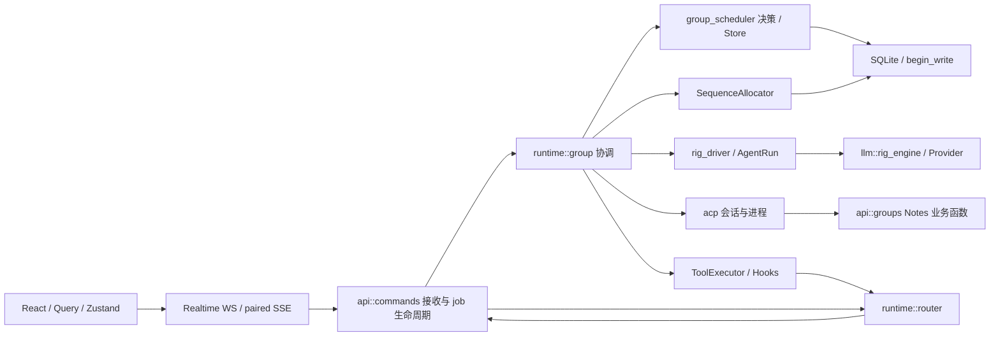

# Qunica Phase 0 架构审计与重构计划

日期：2026-11-07。基线：`master` / `55a8e5ebefd93397e62ece5eb41b9b6afadc0f1c`。

第 1–6 节记录 Phase 0 源码审计与本机验证，不是生产安全认证或线上性能评估。复核开始时 `AGENTS.md` 和 `frontend/src-tauri/icons/icon.icns` 已修改，本报告已有未跟踪草稿；已有改动均保留。Phase 0 没有修改生产源码、测试、CI、依赖或数据库迁移。用户要求继续后的实施范围与本地提交见第 7–9 节；未推送或发布。

## 1. Architecture Audit

### 1.1 结论与证据口径

优先恢复前端测试基线并将 Vitest 接入现有 CI，随后从 Scheduler 的纯策略开始小步调整。不要先搬迁整个 `run_scheduled_turn`，也不要创建第二套 Scheduler、Persistence 或 Transport。

已阅读根 AGENTS、中英文 README、Rig 迁移文档、Realtime/Router 设计与相关本地决策，并检查下述入口、调用方和测试。当前可用 Skill 列表没有请求中的 Superpowers 工作流，因此采用等效审计流程，没有声称使用这些 Skill。本轮未委派其他 Agent。

证据分三类：

- **已确认治理缺陷**：前端 CI 未运行 Vitest；本轮默认完整测试 16 项失败，低并发定向复跑保留 5 项失败；两个失败组有明确隔离/Fixture 问题；严格 Clippy 被现有测试中的冗余绑定阻断。
- **本机非稳定失败**：默认 Rust workspace 在 Provider 契约套件发生一次 loopback HTTP 发送失败，同一编译产物的单用例复跑通过；这不能覆盖原始非零退出，也不能据此确认是产品缺陷或环境根因。
- **结构性风险**：协调器承载多种状态、Runtime↔API 业务依赖环、文件系统与 SQLite 双写、手工协议映射；没有据此宣称已发生越权、重复执行或数据损坏。
- **未验证事项**：真实厂商签名接受、生产恢复、跨平台运行结果、覆盖率、圈复杂度、性能分位数。本报告不借用历史测试数字证明当前 HEAD。

计数使用 `git ls-files '*.rs' '*.ts' '*.tsx'` 和物理行数，包含空行、注释、声明式数据和源码内测试；不含 `.agents`、依赖目录或未跟踪文件。函数范围按 Rust 顶层签名到列首结束括号核对，不是 AST 圈复杂度排名。前端先做字面 import 候选检查，再使用本地 TypeScript AST 复核静态本地 import/re-export；不是完整 bundler 分析。

已有统计保存在 `.agents/audit-2026-11-07/`。本轮重新统计物理行数并复跑 TypeScript AST 依赖检查，验证日志、退出码和 AST 复核脚本保存在 `.agents/audit-sol-2026-11-07/`，按仓库约定不提交。历史日志不作为本轮通过证明。报告中的源码路径与行号均相对于上述基线；后续改动后需重新定位。

### 1.2 代码规模

| 统计范围 | 文件数 | 物理行数 |
| --- | ---: | ---: |
| 全仓受版本控制 Rust | 197 | 142,830 |
| 全仓受版本控制 TS | 171 | 24,580 |
| 全仓受版本控制 TSX | 292 | 63,259 |
| backend crate `src/`（含内联测试） | 131 | 81,551 |
| backend crate `tests/`（含三个子模块） | 35 | 51,285 |
| `frontend/src/`（含测试） | 459 | 87,660 |
| `frontend/src-tauri/` Rust | 10 | 5,100 |
| `android/` Rust | 3 | 254 |
| `mobile-link/` Rust | 4 | 1,514 |

Backend 子目录：Runtime 26 文件 / 23,725 行，API 37 / 29,035，Tools 19 / 8,024，ACP 9 / 6,461，LLM 5 / 2,571。这些是包含内联测试的规模，不能当作纯生产 LOC。

最大的非独立测试文件及审查结论：

| 文件 | 总行数 | 说明 |
| --- | ---: | --- |
| `backend-rs/crates/backend/src/runtime/group.rs` | 11,459 | 主测试模块从 10353 行开始；前 10352 行也含条件编译项。真实压力来自状态与 I/O 交织 |
| `backend-rs/crates/backend/src/api/groups.rs` | 6,498 | 测试模块属性从 6462 行开始；包含 DTO、权限、工作区、Git、Notes 和拓扑 |
| `backend-rs/crates/backend/src/api/agents.rs` | 2,396 | 配置校验、更新与预设；不纳入首 PR |
| `frontend/src/stores/messageStore.ts` | 2,029 | 历史消息、乐观态、Stream、工具活动、Scheduler 投影 |
| `backend-rs/crates/backend/src/acp/mod.rs` | 1,881 | 外部会话与进程生命周期；不能直接套用 Rig 生命周期 |
| `frontend/src/components/chat/WorkspaceFilesTab.tsx` | 1,729 | 文件浏览与交互，单独治理 |
| `backend-rs/crates/backend/src/runtime/compaction.rs` | 1,704 | 第 847 行进入测试属性，不能全部计作生产复杂度 |
| `frontend/src/components/chat/WorkspaceGitTab.tsx` | 1,347 | Git 交互边界 |
| `frontend/src/components/chat/Composer.tsx` | 1,335 | 输入、附件、拖拽、模型/思考配置与尺寸交互 |
| `frontend/src/hooks/useSendMessageStream.ts` | 1,180 | 发送生命周期、事件路由、缓存失效、通知与恢复 |
| `backend-rs/crates/backend/src/runtime/router.rs` | 1,130 | 接受任务、回报、话题及工具边界 |

`frontend/src/types/api.ts` 1416 行及语言资源大文件主要为声明，不应机械拆分。`api/mod.rs::router` 83–768（686 行）主要为路由声明；其长度不意味着与执行循环同等级认知复杂度。

### 1.3 当前架构与实际依赖



明确的模块级依赖环：`runtime/router.rs:21–25` 导入 `api::automations::topics` 和 `api::commands` 中的业务受理函数；`api/commands.rs:1189` 在 `finish_job` 事务中调用 `runtime::router::report_in_tx`。这是业务所有权问题，不是 Rust crate 编译循环，也不应通过复制 SQL 或拆开原子事务解决。

其他反向依赖：`acp/notes_mcp.rs:31–35` 使用 `api::groups`；`tools/app_control/read.rs:72` 使用 Notes 内部 API；`runtime/group.rs:8080–8099` 读取 API 模块的搜索、媒体和 Shell 配置；`runtime/chat_title.rs:136` 又依赖 Group 内的 Provider 解析。建议按实际共享业务提取，而非全 API 强加 Repository。

前端 AST 复核覆盖 316 个非测试 TS/TSX 文件、1547 条静态本地依赖边。包含类型时发现 `api-v2/client → retry → authFetch → authStore → conversationActivityStore → useGroupMessages → useGroupThreads` 等节点组成的一个强连通分量；排除显式 type-only 导入后，未发现静态值依赖环。`conversationActivityStore.ts:23` 是 **type-only** 导入，不能报告为 JavaScript 执行循环。它仍暴露了 Store 类型依赖 Hook 的分层问题；若治理，先将 `ConversationScope` 与 query key 纯定义移到中立模块。扫描不涵盖动态 import、外部包及 bundler 变换，不能据此保证所有运行时加载路径无环。

### 1.4 已有良好设计，应保留

- `group_scheduler/{budget,state,topology,mod}.rs` 已分离预算、合法状态与策略，`store.rs` 持有持久化。不是“缺少 Scheduler”。
- `SequenceAllocator`（`sequence.rs:44`，全文件 768 行）负责线程序号、事件和消息的事务协调；`SchedulerStore::finish_dispatch`（`store.rs:210`）处理终态、输出及 SQLite 锁失败，不能再另造事件仓库。
- `rig_driver.rs` 208 行、`rig_driver/agent_run.rs` 401 行，已经建立宿主驱动 AgentRun 与持久 Checkpoint；工具、审批、取消没有交给 Rig 高层 Runner。`engine_observation.rs:26,82,126` 已记录引擎 intake、状态、累计 active duration 与工具结算统计，未来性能治理先复用观测，不重造一套。
- `db/mod.rs:49` 使用 `BEGIN IMMEDIATE`；不是所有重试都危险：事务级锁重试与重复外部工具执行必须区分。
- Realtime 已有传输分离：`lib/realtime/stream.ts` 117 行、`client.ts` 313 行、`api-v2/sse.ts` 205 行。SSE 第 164 行按 Stream 序号去重；WS 第 234–237 行按每个 listener 的 decimal cursor 过滤并在应用后更新。
- `RIG_MIGRATION.md` 明确旧 native 恢复、签名与 encrypted reasoning、精确审批摘要和 Windows Future 装箱依据。`rig-engine=[]` 已是兼容 feature，`--no-default-features` **仍使用 Rig**，不是原生引擎 A/B。
- 已有大量 SQLite、并发、恢复、Provider 和前端重放测试；不能称“完全没有安全网”。

### 1.5 四个 Runtime 重点函数

| 函数与精确范围（group.rs） | 输入 / 输出 | 职责与副作用 | 安全提取方向 |
| --- | --- | --- | --- |
| `run_scheduled_turn` 1028–2470，1443 行 | services、request、可变 StreamCtx、group、trigger id → TurnOutcome / Cancelled | 选候选、Router 固定席位、预算、受理 turn、Moderator、派发、成员重新校验、输出/终态 | 先刻画 topology frontier、候选顺序与预算输入；I/O 顺序留在协调器 |
| `run_agent_turn_body` 4199–5163，965 行 | services、ctx、candidate、group、handoff depth、delegated input、可选可变 Scheduler、execution id → AgentRunResult / StepErr | ACP 分支、Provider、上下文、恢复检查、模型 streaming、Driver、工具、压缩、用量 | 先收敛执行记录的纯状态转换，不能把不完整输出转成成功历史 |
| `run_acp_agent_turn` 5347–5748，402 行 | services、ctx、agent、group、delegated input、checkpoint flag → 同上 | ACP 配置、完整/增量 Prompt、图片、Notes capability、外部进程、事件适配、用量、终态 | 优先提取纯事件/usage 映射；会话复用与取消继续由 ACP 持有 |
| `execute_tool_batch` 5926–6048，123 行 | Hooks、Step、ctx、agent、executor、calls、checkpoint flag、content、可变 TurnData → 原调用顺序的结果 / StepErr | started 检查点、并发只读批、逐个持久结果、按模型顺序发结果事件 | 当前边界已经相对明确；先补故障窗口测试，不为缩短 Coordinator 直接搬它 |

调用主链：`run_group_turn_with_stream_id:294 → run_inner:939 → run_scheduled_turn:1028 → run_agent_turn:4083 → run_agent_turn_inner:4174 → run_agent_turn_body:4199`。Body 分流到 ACP 或 Rig；模型工具批经 `tool_call_batches:5889 → execute_tool_batch:5926`；AgentAsTool 经 `handle_scheduled_agent_as_tool_inner:6569` 再进入 Agent 执行，具有递归调度与共享预算。Resume 从 `run_thread_resume_with_stream_id:383 → run_resume_inner:3300` 进入已持久执行恢复。

共享状态并非全部是“全局锁”：

| 状态 | 所有者 / 共享范围 | 修改风险 |
| --- | --- | --- |
| pool、write_lock、MCP、HookChain、ActiveTurnRegistry | `RuntimeServices:139`，跨运行共享服务 | 不新增另一个写锁或 Registry；保持锁顺序 |
| stream seq、allocator、scheduled_dispatch、两组 token 累计、private flag、取消、Resume、coalesced event | `StreamCtx:489`，同一调用链可变借用，嵌套 helper 使用 | 提取函数时不能遗失 private、取消或预算记账；不能扩大成全局 Mutex |
| Store、turn id、topology、TurnBudget、helper_claims、Moderator 摘要、recent messages | `ScheduledTurnRuntime:3581`，调度与 helper 协作 | 预算与临时候选、持久状态有不同来源，不能用重建对象清零 |
| execution id、checkpoint version、driver budget、accepted assistant turns、tool records | `TurnData:3620`，模型轮次/审批恢复 | `content_json` 是兼容边界，移动类型必须保持旧 JSON 读取 |
| 进程与 session lease / active Notes capability | `acp/mod.rs`、`session_store.rs`、`notes_mcp.rs` | 取消/释放不能变成 detached 外部执行 |

关键顺序证据：

- `group.rs:4330` 附近在恢复时检测无结果的 started/outcome_unknown，转为 unknown 并停止；不能通过恢复重新生成工具调用。
- `execute_tool_batch` 先记录 started，`5953` 附近持久检查点，再 poll `FuturesUnordered` 的执行；每个完成项立即持久化，之后才等待其他项，最后排序发事件。持久结果顺序与 UI 展示顺序是两件事。
- `persist_turn_checkpoint:6099` 使用 expected version，写失败恢复内存版本；SequenceAllocator 在事务内检查 dispatch 和 checkpoint。不能把内存 version 当提交凭证。
- `pause_for_approval:5183` 保留原参数且无结果；`replay_approved_call:5231` 在新的模型调用前结算原调用。
- `StreamCtx::emit:706` 附近先持久后发送；接收端断开不等价于取消服务端工作。
- `run_agent_turn_body:4230` 附近的 `Box::pin(run_acp_agent_turn)` 有 Windows 嵌套 Future 栈依据；此次不建议移除装箱。

另有一个需定点故障验证的安全审计项：`group.rs:1100–1108` 读取自动任务的预算快照，使用 `.await.unwrap_or(None)`，将 SQL/解码错误与“没有快照”合并；随后 `1109`、`1129` 回退到当前群预算。这条错误路径可能失去已受理任务的更严格预算上限。当前仅确认错误被吞没与回退代码，未通过故障注入证明后续模型/工具仍会派发，也未证明存在可利用输入。应独立刻画查询失败后的行为，若证实越过预算则单独修 Bug，不混入行为保持重构。

### 1.6 API、前端、契约和持久化

`api/groups.rs` 中 DTO/行映射集中在前约 1226 行；生命周期 1451–1986，上传与 Workspace/Git 1987–3068，Notes 3069–3364，Members/Agents 3365–3937，其后是查询、权限、Prompt、路径和文件操作辅助函数。这提供可审查边界，但不是一次按行剪切的方案。

Notes 是优先于简单 CRUD 的 Service 候选：HTTP、ACP 和 AppControl 都调用它。`create_group_note_with_pool:3162` 在数据库事务内插入记录、检查 capability、写文件，commit 后更新 index（约 3191–3213）；SQLite 与文件系统没有共同事务，提交失败/崩溃窗口存在一致性风险，但本次未注入失败证明用户可见损坏。先记录当前失败行为和恢复事实，再独立决定一致性修复；不要把修复混入文件搬迁。`workspace_git_target:2474` 与路径校验应维持同一个授权边界，避免 handlers 拆分后遗漏。

前端五种状态的实际分布：

- 服务端持久消息：Query 拉取，`useGroupMessages` 与 messageStore 合并；服务端 seq 为权威。
- UI 状态：Composer 局部状态、偏好、文件导航；不是 Scheduler 真相。
- 流式临时状态：messageStore 的 per-stream 草稿、reasoning、tool activity；Hook 对事件解码和路由。
- 乐观消息：发送前插入，`user_message` 确认关联；发送 Promise 的确认不等价于 Agent 完成。
- 生命周期投影：messageStore、conversationActivityStore、accountSyncStore 和 Hook 共同协作。Query 与 Store 重复出现并不自动构成错误，但需要逐事件明确谁接纳、谁合并、谁失效。

`useSendMessageStream.ts:728` 的 `onEvent` 先交 Scheduler，再拒绝普通晚到输出（约 732–761）；`messageStore.ts:1669` 的 `applySchedulerEvent` 保持 terminal fence，并允许终态后的 `done` 收敛。应先将这段投影提成纯函数（显式传入时间），保持 Store actions 外观；通知、网络、Query invalidation 留在 Hook。不要另建重复去重器或一次替换整个 Store。

Composer 主组件从 296 行开始，已有 `ComposerMenu`、`ComposerMenuItem`、`PendingAttachmentRow` 组合。可逐个抽附件生命周期或 effort 持久偏好，但不因长度增加 memo/cache；首 PR 不改产品 UI。

契约现状：`domain/src/events.rs:6,43` 定义 Rust kind 与通用 envelope，payload 多为运行时 `Value`；TS `api-v2/types.ts:41,312` 手写 envelope 与 Scheduler union；`schemas.ts` 保留 Zod 校验，Hook 内还有非 Scheduler payload schema。只生成 Rust envelope 无法解决 payload 漂移。

契约建议先选一个 Scheduler payload：Rust 具名 Serialize DTO + 旧 JSON fixture → TS/Zod 同一 fixture 解析，确认 optional/null、额外字段策略及 event_id 不变；通过后才试点 schema 生成。`schemars` 更适合 JSON Schema 中介，`ts-rs` 只生成静态 TS 无法替代 Zod，JSON Schema 转 TS 仍需运行时校验。当前不安装新依赖、不选定全仓生成器；以实际表达能力与增量成本决定。

`backend-rs/Cargo.lock` 已因 rig-agent/rig-core 包含 schemars，但 backend/domain 清单没有将它接成产品 DTO 生成流程。优先评估与锁定版本一致的增量方案；传递依赖存在不等于已有单一契约来源。

迁移目录含 57 个 SQL 文件（0001–0057）。重点兼容点：0049 legacy digest 版本、0050 summary invalidation、0051 引擎观测、0052 Router（库存 bounded + router id，API 映射 router）、0053 话题、0054/0055 Watchdog、0056 idle activity、0057 task job 事件。`db/mod.rs` 中有特定 alpha 迁移 checksum 修复，必须遵守其已验证 schema 条件，不能泛化为“忽略 checksum”。结构重构不应修改这些迁移。

### 1.7 风险分级

| 优先级 | 问题与证据 | 风险 / 收益 | 性质 |
| --- | --- | --- | --- |
| P0 | 本次未证实可立即利用的越权、重复副作用或数据损坏 | 若后续故障注入证明 unknown replay / 审批失配，先停止结构重构并独立修复 | 不虚构阻断缺陷 |
| P1 | frontend CI 缺 Vitest；本轮默认完整测试 16 项失败、定向复跑 5 项失败；严格 Clippy 在 `tests/group_stream/router_mode.rs:1236` 失败 | 恢复现有检查与前端门禁是结构重构的前置条件 | 已确认治理缺陷 |
| P1 | Group 的 StreamCtx、TurnData、Scheduler 混合协调 | 任意 helper 提取均可能改变取消、预算、提交顺序；先建立边界测试 | 结构风险 |
| P1 | Router↔commands 业务受理循环依赖 | 后续改任务/回报需跨层理解；抽共享事务受理可改善所有权 | 结构风险 |
| P1 | Notes DB/文件/index 双写窗口 | 先故障刻画，再决定补偿/修复；不得声称 DB 事务覆盖文件 | 待实证风险 |
| P1 | 自动任务预算快照查询错误被当作无快照（`group.rs:1108`） | 验证是否在数据库读失败后丢失更严格预算，确认后独立修复 | 待故障验证 |
| P2 | Hook 多 Store 投影、手工 DTO/Zod 同步 | 逐事件减少改动影响范围，补跨语言 fixture | 维护风险 |
| P2 | 声明大文件、Workspace 组件、Lint 警告、构建大 chunk | 单独治理；不以 LOC、chunk 大小推断性能故障 | 非首 PR |

## 2. Runtime Invariants：回归测试映射

下表是源码中存在的测试映射，不表示每个测试均在本次成功运行。运行状态以第 5 节为准。Backend 路径相对 `backend-rs/crates/backend/`。

| 不变量 | 已有具体测试 / 位置 | 仍需补充或明确的边界 |
| --- | --- | --- |
| unknown 不自动重放 | `tests/group_stream/rig_scenarios.rs:220` `legacy_native_started_tool_with_no_result_is_never_replayed`；`tests/group_stream.rs:10796,10800` crash-before-result-commit 两引擎用例 | 已有副作用完成但结果未提交的故障测试；提取时复用并核对效果次数，避免重复补相同场景 |
| 批次结果先独立持久化、再按模型顺序发事件 | `tests/group_stream.rs:10917,10921` fast-read-before-slow-sibling 两引擎用例；`group.rs:10732` 只读批次被写操作打断 | 显式覆盖结果写失败后的剩余调用状态、事件顺序；已有快慢兄弟调用测试不能称为缺失 |
| 原 call identity / 一次结算 | `rig_scenarios.rs:269` `rig_read_edit_bash_finishes_with_one_completion_per_attempt`；`:116` legacy approval once | 提取 TurnData 时加 schema 2/3 fixture 的深比较 |
| 审批绑定、精确参数、版本 | `src/runtime/approval.rs:236,254,289,307` 浮点/旧行/零值/持久校验；`tests/realtime.rs:1159` opposing decisions only one resume | 过期、拒绝、换工具权限与复用版本保持失败关闭；不可取消详情读取 |
| 重复审批不执行 | `tests/group_stream.rs:11391` `an_answered_approval_cannot_be_replayed_twice` | 新 Service 必须保留同事务 claim；测试外部效果次数 |
| 截断/非法模型输出不派发 | `rig_scenarios.rs:426` `rig_invalid_or_cut_stream_never_dispatches_or_retries_visible_output` | Body 拆分前验证 accepted history 与 UI fragments 分离 |
| 恢复不重置预算，压缩只能在结算后 | `rig_scenarios.rs:322` overflow/rebuild；`:557` call/failure limits；`:597` token limit | 预算配置快照与 Moderator/Decision 用量边界分别刻画 |
| 取消、supersede、并发占用 | `tests/group_scheduler_concurrency.rs:21,59,88`；`group_scheduler_cancellation.rs:10,21,50` | 控制型屏障测试 dispatch 前后、结果写入前后；不靠 sleep 偶然触发 |
| 启动恢复不会伪造成功输出 | `tests/group_scheduler_recovery.rs:18` startup recovery | 保留 waiting approval；旧 worker generation 不能收尾新任务 |
| 数据与事件原子、线程顺序 | `group_scheduler_concurrency.rs:130,195,258` SQLite 写锁；`tests/group_stream.rs:4825,4899,4929` replay/idempotency | 写入失败与发送失败不同；客户端断开不能取消已接受 job |
| Provider native 元数据保留 | `tests/llm_contract.rs:1222,1738,1788,1841`；`group_stream.rs:10596,10600` 审批重启签名 | 本地 fixture 不证明真实供应商接受；跨 model/context 拒绝须保留 |
| ACP 进程取消 / 会话复用 | `tests/acp_lifecycle.rs:573,677,1111` timeout/cancel/reuse；`:31` env 隔离 | 提取事件转换不得吞 join failure、权限和 Notes lease |
| 工具权限、Workspace 隔离 | `rig_scenarios.rs:529` disabled shell；`tests/workspace_tools.rs`、`tests/workspaces.rs`；Shell 模块测试 | 新增工具无需修改模型 loop 是治理目标，不可通过放宽 catalog 达成 |
| Router 任务与回报 | `tests/group_stream/router_mode.rs`；`api/commands.rs` finish_job 竞争测试 | 抽受理业务时验证 job terminal + report 原子性、ownership、topic 订阅 |
| AgentAsTool 私有输出与预算 | `tests/agent_as_tool.rs`；`group_stream.rs:7374,7378` nested cancellation | Windows 装箱边界与递归取消不变；不用更大线程栈掩盖失败 |
| Stream 去重、乱序、终态、并发 | `frontend/src/lib/api-v2/sse.test.ts:14`；`lib/realtime/client.test.ts:41,63,89`；`stores/messageStore.test.ts:90,184,359,437,512` | Store 投影不负责重新决定后端执行；未来纯 reducer 单测直接重放同一 fixture |
| 乐观确认、恢复、导航隔离 | `hooks/useSendMessageStream.test.tsx:234,264,328,400,539,742,848,891` | 取消与异步 snapshot 回来、terminal 后 done 仍需端到端组合测试 |
| 自动任务受理预算与当前限制取交集 | `tests/automations.rs:343` 已断言自动任务预算限制 Runtime | 补预算快照 SQL/解码失败的安全行为，不把正常路径断言等同错误路径覆盖 |

没有测量核心状态机覆盖率或变异分数；不将测试数量等同覆盖率。可在纯状态机稳定后评估 property-based tests，而非先引入全仓工具链。

## 3. Refactoring Roadmap

每项原则上单独 PR；风险指实施风险，不是发现的漏洞等级。依赖顺序：R01 → R02；R13 在 Runtime 搬迁前完成故障刻画，若证明越过预算则先独立修复；R03–R05 依赖可靠 Runtime 基线；R06–R10 可按模块依次推进；R11 在已有契约 fixture 后进行。

| ID | 目标 | 问题 | 具体改动与边界 | 风险 | 验证 | 优先级 |
| --- | --- | --- | --- | --- | --- | --- |
| R01 | 前端测试确定性 | 通知窗口污染、详情 fixture 失配 | 只修两个测试文件隔离/返回契约；保留全部业务断言 | 低 | 定向 + 完整前端测试 | P1 |
| R02 | 前端 CI 门禁 | CI 不执行 test | 原 frontend job 添加 filter test；CI Node 20 验证资源表现 | 低 | 完整测试、Lint、类型、Build；故意失败探针确认 job 非零退出；合并保护另核对仓库配置 | P1 |
| R03 | 调度策略刻画 | Frontier 与协调器交织 | 给 topology_frontier 补 ring/star/hierarchy/empty/order 表驱动测试，暂不移动 | 低 | lib 定向 + Scheduler 四套集成 | P1 |
| R04 | 提取 frontier 纯函数 | 改拓扑要理解 group | 移至已有 group_scheduler/topology.rs，保留函数顺序语义；不移动数据库候选重验 | 中低 | R03 + group_stream + workspace 两 feature 配置 | P1 |
| R05 | 执行记录边界 | TurnData 与 I/O 相邻 | schema 2/3 和未知字段策略刻画后，独立提取记录转换；暂不移动工具执行 | 中 | 审批重启、unknown、Provider 完整回归 | P1 |
| R06 | 调度终态收敛 | Coordinator 多处分支结束 | 先画状态/事件序列，再仅提取已有终态流程，保持调用顺序 | 高 | cancel/supersede/persistence failure、完整 Runtime 回归 | P1 |
| R07 | 共享命令受理 | Runtime↔API 依赖环 | 一次只抽 enqueue/accept 事务核心到现有业务边界；HTTP DTO 外观不变 | 高 | realtime、Router、automation、并发、旧 worker 防护 | P1 |
| R08 | Notes 业务归属 | HTTP/ACP 复用 API，双写 | 先故障注入独立 PR；后续提取共享业务；一致性修复另立 Bug PR | 中高 | groups、ACP Notes、撤销 guard、提交/文件故障 | P1 |
| R09 | Group Git handler 模块 | 文件/鉴权/响应混合 | 一次仅 Git 路由及私有辅助，保持 api/mod 路由与错误映射 | 中 | groups、workspaces、权限/路径、路由响应契约 | P2 |
| R10 | Scheduler 前端投影 | Hook/Store 事件分支耦合 | 提取 applySchedulerEvent 的纯变换，显式时间和接纳结果；外部 action API 保留 | 中 | duplicate/late/terminal/done/concurrent/replay + 前端全套 | P2 |
| R11 | 单 payload 契约来源 | Rust Value / TS / Zod 手工同步 | 一个 Scheduler DTO 和共享 fixture；评估生成器后另 PR 引入 | 中 | Rust serialize → TS Zod，optional/null、未知 kind、旧 JSON | P2 |
| R12 | 渐进质量规则 | 没有本次复杂度变化基线 | 报告 touched 函数范围与跨层 import 增量，例外注明；禁止新增反向业务依赖 | 低 | 脚本 fixture、对当前 HEAD 自检、PR 只报增量 | P2 |
| R13 | 预算快照故障刻画 | SQL 错误回退到当前群上限 | 仅注入预算读取失败，断言不得在丢失已受理上限时继续派发；若现行为不满足则另开 Bug 修复 | 中 | 自动任务预算、SQL 故障、Provider/Tool 调用计数 | P1 |

R01/R02 可作为一个“前端测试门禁”PR 的两个提交；它们共同完成一个治理意图。首个实际 Runtime 结构 PR 是 R03/R04，不能与 CI/测试修复混为大型重构。

性能阶段暂不启动。未来若有慢路径，再分别采集首 token、tool dispatch、Scheduler 决策、SQLite 写锁等待、resume 与前端 render 频率，固定 fixture/机器/并发度并报告 p50/p95。此次不改变缓存、并发度、批处理、重试或 coalescing，不宣称更快。

## 4. First PR Plan：先恢复可信的测试门禁

建议标题：`test: restore regression gates before runtime refactoring`。产品行为预期完全不变。首 PR 合并 R01/R02 的前端安全网，并以独立小提交修复已阻断现有 Clippy 的单行测试冗余绑定；共同意图为恢复可信门禁，不包含 Runtime 结构调整。

### 4.1 可复现根因与最小范围

1. `frontend/src/hooks/useConversationActivity.test.tsx:91` 的 beforeEach 重置 Store、Mock 和 localStorage，却没有清理 `replyNotifications.ts:112` 的模块级 `windows`。前一个测试发起的通知留下 20 秒窗口，后续同 conversation 的通知被正常合并，Mock 计数为零。已有 `clearReplyNotificationWindows():113` 可复用；`replyNotifications.test.ts:55,147,198` 已使用它。整文件 4 项通知失败，而单独运行首个通知用例通过，支持测试污染判断。计划在前后清理窗口与计时器，按现有测试约定恢复 spy；保留“通知一次”和内容断言，不能关闭生产合并逻辑。
2. `frontend/src/pages/settings/AppActionsPage.test.tsx:44` 对所有 fetchJson 请求返回 `{items,...}`；`AssistantApprovalCard.tsx:43–46` 经 `useAppAction` 查询 `/app-actions/:id` 并要求 `status === 'pending'`。列表 fixture 没有顶层 status，因此安全地隐藏按钮。计划按请求路径返回列表、详情与 settings；未知请求让 fixture 明确失败。等待详情完成后仍断言只有 pending 行可操作，并覆盖 detail 404/error/terminal 不显示批准按钮。不得绕过详情读取，不能只改按钮文本或删除断言。
3. `.github/workflows/ci.yml` 现有 frontend job：Install → release workflow check → Lint → Type check → Build。增加 `pnpm --filter @qunica/frontend test` 步骤，建议在 Type check 后、Build 前。根 `package.json` 无 test 脚本，不能直接写 `pnpm test`。
4. `backend-rs/crates/backend/tests/group_stream/router_mode.rs:1236` 的 `let dispatch_two = dispatch_two;` 被当前 Rust 1.97.1 的严格 Clippy 判为 `redundant_locals`。闭包已有 `move`，计划仅移除重复绑定，保留闭包捕获、测试输入和全部断言；运行对应测试与严格 Clippy。不得新增 allow 来屏蔽此问题。

首 PR 预计只涉及上述三个测试文件及 CI；如必须调整 test 配置，应单列资源数据与理由。默认并发下其他初跑失败不能算已修复；先在与 CI 相同 Node 20 下核验完整套件，若仍稳定失败，独立定位后再纳入同一安全网意图。不要增加全局 timeout、skip 或删除用例。

### 4.2 实施与验证顺序

1. 重新检查 HEAD、dirty files 和基线；创建 `codex/frontend-test-gate` 独立分支/工作树，保留用户改动。
2. 不改源码，重现两个失败组并保存日志；先补详情失效安全边界断言，再修 fixture/隔离。
3. 运行定向测试，确认没有卸载残留窗口与定时器，不新增隐藏 Mock；检查重复运行和单独运行一致。
4. 在 Node 20 / pnpm 9.15.0 的 frozen lockfile 环境跑完整套件。若只在高并发资源竞争下失败，比较原配置与受控并发结果后再决定 CI worker 限制，不将限制描述为产品性能优化。
5. 接入原 CI job，验证失败测试确实导致该 job 非零退出；临时失败探针不得保留在提交中，不使用 continue-on-error。
6. 执行以下命令；首 PR 只改 Rust 测试的冗余绑定，仍验证对应测试及已失败的严格 Clippy。后续 Runtime PR 再执行完整 Rust/Tauri 相关回归。

```sh
pnpm install --frozen-lockfile
pnpm --filter @qunica/frontend run test src/hooks/useConversationActivity.test.tsx src/pages/settings/AppActionsPage.test.tsx
pnpm --filter @qunica/frontend test
pnpm lint
pnpm type-check
pnpm build
cargo test --locked --manifest-path backend-rs/Cargo.toml -p qunica-backend --test group_stream send_to_task_takes_a_slot_for_idle_tasks_but_queues_on_running_ones
cargo fmt --manifest-path backend-rs/Cargo.toml --all --check
cargo clippy --locked --manifest-path backend-rs/Cargo.toml --workspace --all-targets --all-features -- -D warnings
node scripts/check-release-workflow.mjs
git diff --check
```

评审必须检查：断言没有弱化；通知合并仍有独立测试；审批状态仍来自详情；HTTP 实际调用未被无差别 Mock 成成功；CI 节点版本与依赖安装可复现；无产品源码、协议、数据库变化。

完成判据：两组失败根因消除、完整前端套件在 CI 通过、故意失败能阻断 job、严格 Clippy 和对应 Rust 测试通过、Lint/Type Check/Build 通过且现有警告未新增；原安全断言保留；本报告列出的未决高并发失败被定位或有明确环境证据。纯测试/CI PR 可用正常 revert 回滚，不动用户数据，不移除生产审批守卫。Runtime 后续 PR 的回滚仅回滚代码；不能降级已迁移数据库或重放 unknown 副作用。

### 4.3 安全网后的第一个 Runtime 结构 PR（R03/R04）

目标仅为让拓扑候选计算能够在 Scheduler 模块内独立理解和测试。范围：`group.rs::topology_frontier`（2472–2526）、已有 `automatic_mesh_keeps_the_previous_speaker_in_the_moderator_frontier`（10574），以及 `group_scheduler/topology.rs` / 必要的内部 re-export。不移动 Candidate 加载、静音重验、Moderator 调用、预算消费、事件或 SQL。

先保持原函数位置补测试，再迁入已有 topology 模块，采用最小可见性，输入仍为 TopologySnapshot、候选 ID 顺序、上一发言者；输出仍是有序 ID。不引入 Trait、额外配置或可变共享状态。

必须刻画：Mesh 保留前一 speaker；Star 有 hub 时首次只选 hub、缺 hub 的现行为；Hierarchy 有/无可用 leader；Ring 首次按 topology order、从 previous 后环绕、跳过不可用成员、unknown previous 返回空、不能选回自身；空候选；候选顺序与 topology 顺序不同。非法 topology 的处理先以现函数为准，不能顺手改为修复输入。当前 mesh 已有专门回归，其他分支的独立纯函数矩阵不足，不代表集成测试完全没覆盖它们。

建议依次运行（仓库根目录）：

```sh
cargo test --locked --manifest-path backend-rs/Cargo.toml -p qunica-backend --lib
cargo test --locked --manifest-path backend-rs/Cargo.toml -p qunica-backend --test group_scheduler --test group_scheduler_cancellation --test group_scheduler_concurrency --test group_scheduler_recovery
cargo test --locked --manifest-path backend-rs/Cargo.toml -p qunica-backend --test group_stream
cargo fmt --manifest-path backend-rs/Cargo.toml --all --check
cargo clippy --locked --manifest-path backend-rs/Cargo.toml --workspace --all-targets --all-features -- -D warnings
cargo test --locked --manifest-path backend-rs/Cargo.toml --workspace
cargo test --locked --manifest-path backend-rs/Cargo.toml --workspace --no-default-features
cargo check --locked --manifest-path frontend/src-tauri/Cargo.toml --all-targets --features rig-engine
```

完成判据是新旧候选向量逐项一致、既有 dispatch 与事件序列不变、所有相关验证通过，且 Coordinator 失去这项纯计算实现责任。不是以减少 55 行作为成功指标。回滚为正常 revert 该独立提交；无迁移、无运行状态修复或重放。

## 5. 本次验证记录

本轮环境：Windows / PowerShell，Rust/Cargo 1.97.1，Node 22.23.2，pnpm 9.15.0；CI frontend 使用 Node 20，二者不等价。已有 node_modules 可执行，本轮没有重装依赖或修改 lockfile。下列日志及退出码均在 `.agents/audit-sol-2026-11-07/`；不借用历史记录。全仓测试的两种 Cargo 配置和前端受控并发诊断曾同时执行，资源竞争属于本轮测量条件，不能把结果当作隔离性能基准。

| 实际命令（仓库根目录） | 退出状态与观察 | 日志 |
| --- | --- | --- |
| `cargo fmt --manifest-path backend-rs/Cargo.toml --all --check` | 0，通过 | `fmt.log` |
| `cargo clippy --locked --manifest-path backend-rs/Cargo.toml --workspace --all-targets --all-features -- -D warnings` | 101，现有 `tests/group_stream/router_mode.rs:1236` redundant_locals；未修源码/测试、未加 allow | `clippy.log` |
| `cargo test --locked --manifest-path backend-rs/Cargo.toml -p qunica-backend --test group_scheduler --test group_scheduler_cancellation --test group_scheduler_concurrency --test group_scheduler_recovery` | 0，12 + 3 + 6 + 1 = 22 通过 | `scheduler-test.log` |
| `cargo test --locked --manifest-path backend-rs/Cargo.toml --workspace` | 101，执行至 `llm_contract` 时 59 通过 / 1 失败：`on_each_provider_entry::llm_contract_openai_never_sends_a_thinking_budget` 在 `llm_contract.rs:891` 向 loopback fixture 发请求失败；后续测试目标未运行。此前 `group_stream` 为 197 通过 / 1 既有忽略 | `rust-workspace.log` |
| `./backend-rs/target/debug/deps/llm_contract-1a4c2c4a38e59ba1.exe --exact on_each_provider_entry::llm_contract_openai_never_sends_a_thinking_budget --nocapture` | 0，同一编译产物单测复跑 1 通过 / 59 filtered；Factory、Direct 两入口均经过，不代表完整套件转绿 | `llm-contract-recheck.log` |
| `cargo test --locked --manifest-path backend-rs/Cargo.toml --workspace --no-default-features` | 101，编译遭遇 Windows OS 1455（页面文件太小，无法 mmap backend rlib），报 E0786；完整测试未执行，不认定为 crate 元数据损坏或产品断言失败 | `rust-no-default.log` |
| `pnpm --filter @qunica/frontend test` | 1，134 文件通过 / 10 失败；1103 测试通过 / 16 失败 | `frontend-test.log` |
| `pnpm --filter @qunica/frontend run test --maxWorkers=2 src/hooks/useConversationActivity.test.tsx src/pages/settings/AppActionsPage.test.tsx src/stores/messageStore.test.ts src/hooks/useSendMessageStream.test.tsx src/lib/api-v2/sse.test.ts src/lib/realtime/client.test.ts` | 1，4 文件通过 / 2 失败；71 测试通过 / 5 失败；Store、Send Hook、SSE、WS 四个文件通过 | `frontend-targeted.log` |
| `pnpm --filter @qunica/frontend run test src/hooks/useConversationActivity.test.tsx -t 'announces a finished reply once'` | 0，1 通过 / 6 按过滤器跳过；与整文件失败对比支持隔离污染判断，不是删除/skip 测试的修改 | `notification-isolated.log` |
| `pnpm --filter @qunica/frontend run test --maxWorkers=2` | 1，141 文件通过 / 3 失败；1113 测试通过 / 6 失败。前述 5 项加 DirectChatPickerDialog 的导航断言失败；仅作诊断，不替代默认命令 | `frontend-full-bounded.log` |
| `pnpm --filter @qunica/frontend run test --maxWorkers=1 src/components/direct-chats/DirectChatPickerDialog.test.tsx` | 0，单文件 2 通过；说明上次导航失败未在隔离复跑重现，不代表已修复或已查明根因 | `direct-chat-isolated.log` |
| `pnpm lint` | 0，0 errors / 14 既有 react-refresh warnings | `lint.log` |
| `pnpm type-check` | 0，通过 | `type-check.log` |
| `pnpm build` | 0，通过；有既有大 chunk 警告，未测运行性能 | `build.log` |
| `node scripts/check-release-workflow.mjs` | 0，通过 | 本轮命令输出 |
| `git diff --check` | 0，无 whitespace 错误；提示已有 AGENTS 换行转换 | 本轮命令输出 |

前端默认完整测试的失败文件：AppActionsPage、AppLayoutOverlay、SystemSettingsPage、WorkspaceFilesTab、GroupManagementI18n、Composer、AutomationsPage、DecisionSettingsPage、AndroidShell、useConversationActivity。受控并发完整复跑还出现 DirectChatPickerDialog 的导航断言失败；诊断时少量超时/交互失败随并发条件变化，不能宣称全是机器原因或已经修好。稳定的两个失败组根因见 4.1；其余仍需在与 CI 一致的环境隔离复核。

未执行：`pnpm install --frozen-lockfile`（复用已有依赖，未验证干净安装）、Tauri check、Android 构建、Docker 构建/依赖测试、Linux/macOS 本机验证、真实 Provider 请求、性能/覆盖率/变异测量。此次无产品源码改动，以上均不标记为通过；首 PR 与后续 Runtime PR 的门槛分别见 4.2、4.3。

## 6. 边界与后续决策

本次未实施上述 PR。未调用真实 LLM、生产数据库、云电脑或远程写接口，未执行部署。集成测试可能启动本地 fixture 进程、Shell 和临时 SQLite，仅用于既有测试。

本机为 Windows；跨平台 CI 成功、Android、Docker、Tauri 及真实厂商行为需对应平台验证，源码中存在门禁不等于本次已经通过。现有 Docker 依赖 ignored 测试也不能当作已运行。

后续最重要的决策不是目录命名，而是明确业务受理/完成事务的所有者、Notes 双写失败行为和 Scheduler 纯策略输入。每次提取只移动已刻画的职责，不同时改算法、Schema、重试、权限或性能策略。

## 7. 首个 PR 实施记录：测试门禁

分支 `codex/frontend-test-gate`，起点为 `55a8e5e`，验证后的五文件变更已保存为独立本地提交 `af14499`。用户要求继续后，修改范围为五个文件：

- `useConversationActivity.test.tsx`：测试前后调用已有 `clearReplyNotificationWindows`，卸载 Hook 并恢复 spy，保留全部通知次数和内容断言。
- `AppActionsPage.test.tsx`：分别模拟列表、详情和系统设置接口；未知请求显式报错。等待详情加载后检查 pending 行可操作，新增详情 404、503、已 applied 时禁止审批的三项回归，仍要求无批准/拒绝按钮且不发 POST。
- `tests/group_stream/router_mode.rs`：仅删除冗余 `dispatch_two` 绑定，闭包捕获、输入和断言保持不变。
- `.github/workflows/ci.yml`：原 frontend job 的 Type check 与 Build 之间加入 `pnpm --filter @qunica/frontend test`，没有 continue-on-error。
- `frontend/vitest.config.ts`：worker 上限为 2，保留原有 timeout、隔离和全部测试；以执行时间换取资源可控。默认并发在 Node 20 下再次出现两个 5 秒超时，故增加这一测试配置文件；不是产品性能优化。

本轮验证日志和退出码存于 `.agents/frontend-test-gate/`。修改前定向 13 项测试为 8 通过 / 5 失败；修改后 Node 20.20.2 下受影响页面、通知及合并策略共 65 项通过。冻结依赖安装、对应 Router 测试、严格 Clippy（`-j 2` 限制编译资源）、格式检查、Lint（14 项既有警告）、Type Check、Build（既有 chunk 警告）及 release workflow 校验均通过。

Node 20.20.2 和 Node 22.23.2 的完整前端测试均为 144 文件 / 1122 项全部通过。本机两次完整回归分别耗时 331.38 秒和 298.32 秒，仅记录验证成本，不是隔离性能基准。临时失败探针经现有 pnpm test 脚本返回 1，文件已删除；这验证本地失败能传播，不证明远程 required-check 配置或 GitHub CI 已运行。

| 实际验证 | 结果 / 日志（相对 `.agents/frontend-test-gate/`） |
| --- | --- |
| `pnpm install --frozen-lockfile` | 0，lockfile 未变 / `install.log` |
| `pnpm dlx node@20 .agents/frontend-test-gate/run-node20.mjs --maxWorkers=2` | 0，Node 20.20.2，144 文件 / 1122 测试通过 / `full-node20-bounded.log` |
| `pnpm --filter @qunica/frontend test` | 0，Node 22.23.2，144 文件 / 1122 测试通过，采用配置中的 worker 上限 / `full-default.log` |
| `pnpm lint`、`pnpm type-check`、`pnpm build` | 均为 0 / `lint-final.log`、`type-check.log`、`build.log` |
| `cargo test --locked --manifest-path backend-rs/Cargo.toml -j 2 -p qunica-backend --test group_stream send_to_task_takes_a_slot_for_idle_tasks_but_queues_on_running_ones` | 0，1 通过 / `router-test.log` |
| `cargo clippy --locked --manifest-path backend-rs/Cargo.toml --workspace --all-targets --all-features -j 2 -- -D warnings` | 0 / `clippy.log` |
| `cargo fmt --manifest-path backend-rs/Cargo.toml --all --check`、`node scripts/check-release-workflow.mjs`、`git diff --check` | 均通过 / 本轮命令输出 |

Node 20 的本地 runner 显式以 `frontend` 为 cwd，等价执行包内 `vitest run`。一次从仓库根目录用 `--root frontend` 的诊断调用触发共享 Markdown 的 Vite 文件访问拒绝；该不同调用方式不作为 CI 根因，已用正确 cwd 复核。新加 worker 配置不扩大 Vite 文件访问范围。

未修改产品源码、权限、API、Runtime、数据库迁移、依赖或 lockfile。Rust 仅改测试捕获的冗余局部绑定，本轮未重复执行完整 workspace / no-default-features；Phase 0 的失败记录仍保留，不被定向通过覆盖。远程 CI、Linux/macOS/Android/Tauri/Docker 未在本轮验证。回滚只需撤销上述五个文件的相关修改，不操作数据、不重放工具。

## 8. R13：预算快照读取失败时停止派发

本轮分支 `codex/automation-budget-fail-closed` 从 `af14499` 创建，修复保存为独立本地提交 `fe1b728`。路线图要求 R13 在 Runtime 搬迁前完成；故本轮不移动 topology_frontier，缺陷修复与纯重构保持独立。对照 worktree 已在确认干净后移除，日志保留。

### Problem

真实自动任务受理后，`run_scheduled_turn` 以 `.unwrap_or(None)` 忽略预算快照 SQL/解码错误，随后采用当前群预算。三个故障注入测试分别覆盖非法 JSON、非整数字符串步骤预算、非整数字符串 Token 预算：旧代码三项均失败，临时工作区实际生成了模型要求写入的文件。这证明损坏快照可沿错误回退路径继续执行，不代表正常 API 能创建这些非法快照，也不构成远程越权利用证明。

### Decision

预算读取成功仍走原来的无快照/预算交集逻辑，读取失败则记录错误并使用已有 fail 路径停止回合。新增注释说明不能将读取失败当作无快照。没有新重试、默认预算、工具授权、事件 kind、Schema 或迁移。

新增 await 暴露出 Windows 栈回归：预算错误分支未执行时也影响协调器 Future 的存储。隔离 worktree 的 `af14499` 在相同默认栈上通过同一个嵌套 handoff 用例；候选代码未装箱或只装箱错误分支时溢出；在 `run_inner` 入口装箱整个协调器后，9 项既有嵌套成功/静默/失败/取消/预算回归全部通过，三个预算故障用例也再次通过。`RUST_MIN_STACK` 未设置、未修改。该必要存储边界增加一次 Future 分配，仍同步 await，不创建后台任务；理由已同步至 `RIG_MIGRATION.md` 的 Driver stack boundary。本轮实际源码/测试/协议说明范围为这两个 Rust 文件和该迁移文档，不混入拓扑提取。

`tests/group_stream/rig_scenarios.rs` 复用真实 API、SQLite、任务 Worker 与已有 Provider fixture。SQL trigger 在受理事务提交前注入损坏快照，避免依赖调度时序；测试表和 trigger 仅位于临时测试数据库。修复后三项均通过：Provider 请求数为零、文件不存在、dispatch 为零、job/turn 均 failed，持久事件包含按序 error/done。没有 Mock 待验证的宿主执行循环。

### Alternatives considered

不做 / 复用现有错误回退能保留现行为，而且数据库完全不可用时后续写入也常失败，但已不能解释列解码失败后仍写出文件的证据。回退为最小预算有可用性优势，却擅自替代已接受的执行约束，无法证明安全。统一重写全部自动任务预算读取可同时治理 timeout，但超出本次已确认步骤/Token 查询错误路径；不与此修复混合。

### Consequences

损坏或暂时无法读取预算的任务现在显式失败，不能用群预算继续执行。有效快照与普通消息不变；失败状态与事件复用已有提交机制。代价是这类任务需要明确处置，不能自动重放；回滚代码会恢复原错误回退风险，不改库、不降级 Schema、不重跑工具。独立的 `commands.rs` timeout 读取错误回退不在本轮修复或测试覆盖内，需要单独验证；若正常任务被误拒、出现权限/预算恢复漂移或终态不收敛，必须重访。

本轮验证日志在 `.agents/automation-budget/`。修改前 automations 集成基线 10 项通过，新增故障回归为 0 通过 / 3 失败；修复后三项通过。最终代码的格式、严格 Clippy、Windows Tauri `--all-targets --features rig-engine` 编译检查通过。

中间候选的完整记录保留：默认 workspace 返回 101，`group_scheduler_concurrency.rs:242` 的既有耗时断言失败（5 通过 / 1 失败），后续目标未运行；同一产物单独复跑该用例通过。该用例直接调用 SequenceAllocator，不经过预算读取；释放锁前等待 10ms，却要求总耗时至少 20ms，需独立治理时序依赖。本轮保留断言，没有增大重试或 sleep。未装箱候选的 no-default 和相关套件则异常退出于 Windows 嵌套栈溢出；这属于本轮发现并修正的候选回归，不当作无关基线失败。

最终完整矩阵以 `-j 2 -- --test-threads=4` 控制验证进程资源，保留全部测试及单用例内部的并发；不改变生产调度、不扩大线程栈。默认特性和 no-default-features 均返回 0，各汇总 42 个结果段：1169 通过、0 失败、7 既有忽略；其中完整 group_stream 均为 200 通过 / 1 既有忽略。忽略项包括安装态 CLI 只读检查、1 GiB 临时文件验收和 5 个 Docker 用例，没有新增 ignore。前端及其契约没有改动，沿用第 7 节的验证事实，不声称本轮重复执行前端全套。

| 最终验证命令（仓库根目录） | 结果 / 日志（相对 `.agents/automation-budget/`） |
| --- | --- |
| `cargo test --locked --manifest-path backend-rs/Cargo.toml --workspace -j 2 -- --test-threads=4` | 0，1169 通过 / 7 既有忽略；`workspace-final.log` |
| `cargo test --locked --manifest-path backend-rs/Cargo.toml --workspace --no-default-features -j 2 -- --test-threads=4` | 0，1169 通过 / 7 既有忽略；`no-default-final.log` |
| `cargo clippy --locked --manifest-path backend-rs/Cargo.toml --workspace --all-targets --all-features -j 2 -- -D warnings` | 0；`clippy-final.log` |
| `cargo check --locked --manifest-path frontend/src-tauri/Cargo.toml --all-targets --features rig-engine -j 1` | 0，Windows；`tauri-final.log` |
| `cargo test --locked --manifest-path backend-rs/Cargo.toml -j 1 -p qunica-backend --test group_stream nested` | 0，9 项通过；`nested-boxed.log` |
| `cargo test --locked --manifest-path backend-rs/Cargo.toml -j 1 -p qunica-backend --test group_stream automation_budget_stops_before_dispatch` | 0，3 项通过；`green-final.log` |
| `cargo fmt --manifest-path backend-rs/Cargo.toml --all --check`、`git diff --check` | 均通过 |

本轮没有推送或远程 CI 结果，没有执行 Linux/macOS/Android/Docker 或真实厂商验证。原有写锁用例的时序依赖不因最终矩阵通过而视为已修复；独立修正及验证见第 9 节，timeout 读取错误回退仍为后续项。回滚为正常撤销 `fe1b728`，不操作持久数据，也不自动重放失败任务。

## 9. SQLite 重试测试的因果同步

分支 `codex/sqlite-retry-test-sync` 从 `fe1b728` 创建，只修改 `backend-rs/crates/backend/tests/group_scheduler_concurrency.rs`。目标是消除第 8 节实测的时间断言竞态，建立可靠重试安全网；没有提取 Runtime 模块或改动生产代码。

### Problem

`finishing_a_dispatch_retries_a_transient_sqlite_write_lock` 与 `persisting_a_stream_event_retries_a_transient_sqlite_write_lock` 在实际写入前发出 entered 信号，主任务等待 10ms 后释放写锁，再用总耗时至少 20ms 推断发生重试。信号只证明写入任务已进入，未证明数据库尝试已经失败；工作线程延迟时可能直到释放锁后才开始写入。第 8 节出现的默认 workspace 失败与隔离复跑通过均保留为证据，不能靠删掉断言、放宽时间或增加生产重试处理。

### Decision

两个用例复用已有 SQLite 重试 warning，以模块 target、WARN 级别及 `attempt` / `error` 字段识别真实重试。私有 helper 为每个写入 Future 安装独立 subscriber，在首次 warning 回调中通知主测试并暂停专用 blocking worker。主测试确认信号、确认写入尚未完成，执行真实阻塞事务的 rollback，然后明确放行该 worker。回调不阻塞测试的异步执行线程，不设置全局 subscriber；5 秒超时只防止测试挂死，不承担业务正确性判定。

`finish_dispatch` 原有完成状态和消息身份断言保留，并增加消息与事件各一条的数据库断言；SequenceAllocator 原有事件计数一条的断言保留。实际 SQLite、事务、重试、持久化代码全部照常执行，没有 Mock 核心写入。没有新依赖或修改日志、生产 timeout、重试次数和退避间隔。

### Alternatives considered

不做 / 复用原 barrier 最简单，也保留原测试结构，但无法证明数据库失败发生在解锁之前。只等待 warning 再解锁减少辅助代码，却仍要求主任务在有限重试窗口内及时获得调度。增加 sleep、重试或 timeout 可以降低偶发失败概率，但没有建立因果顺序。新增生产测试 hook 更直接，却扩大生产接口；现有观测点已经足以隔离测试同步。

### Consequences

测试必须观察到真实重试才能通过，并继续验证最终状态与唯一写入。代价是两个用例各增加一个 blocking worker，且测试依赖已有 warning 的元数据；观测字段或模块路径变化时测试会明确失败，需要同步审查。没有持久化格式、协议、审批或工具权限变化；回滚只撤销该测试文件的独立提交，不操作数据库、不重放任何任务。另一个取消等待用例的 150ms 延迟仍保留，未混入本次修正。独立的 `commands.rs` timeout 读取错误回退仍待刻画和修复。

### Verification

修改前定向基线 6 项通过，符合问题为偶发时序失败的事实；修改后定向 6 项通过。临时对照文件验证两点：将观测 target 改成不存在的 target 后，用例明确失败并返回 101（缺失重试信号）；在收到信号后、解锁前额外等待 100ms，用例通过（0），该延迟超过生产两次 25ms 退避之和。两个临时文件均已删除，没有永久增加 sleep。

日志与退出码在 `.agents/sqlite-retry-test-sync/`：

| 实际验证命令（仓库根目录） | 结果 / 日志 |
| --- | --- |
| `cargo test --locked --manifest-path backend-rs/Cargo.toml -j 1 -p qunica-backend --test group_scheduler_concurrency` | 0，修改前后均为 6 项通过；`baseline.log`、`targeted.log` |
| `cargo test --locked --manifest-path backend-rs/Cargo.toml -j 1 -p qunica-backend --test group_scheduler --test group_scheduler_cancellation --test group_scheduler_concurrency --test group_scheduler_recovery` | 0，12 + 3 + 6 + 1 = 22 项通过；`scheduler-default.log` |
| 同上并加 `--no-default-features` | 0，22 项通过；`scheduler-no-default.log` |
| 默认配置编译产物 `group_scheduler_concurrency-78a95e45298d9c3f.exe` 连续执行 10 轮 | 每轮退出码均为 0，每轮 6 项通过；`repeated.log`、`repeated-status.log` |
| `cargo clippy --locked --manifest-path backend-rs/Cargo.toml --workspace --all-targets --all-features -j 2 -- -D warnings` | 0；`clippy.log` |
| `cargo fmt --manifest-path backend-rs/Cargo.toml --all --check`、`git diff --check` | 均为 0；`fmt.exit`、`diff-check.exit` |
| 两个临时对照探针（不存在 target / 解锁延迟） | 预期失败 101 / 预期通过 0；`missing-signal.log`、`delayed-parent.log` |

本次仅变更单个 Rust 集成测试文件，未重复执行完整 workspace、Tauri、前端或其他平台；第 8 节的完整矩阵属于前一提交，不冒充本次执行结果。没有远程 CI、跨平台或性能结论。用户已有的 AGENTS 和图标改动保持原状，本报告仍作为未跟踪审计交付物保留。

## 10. R03/R04：拓扑候选策略的行为刻画与归属

起点为 `fe1b728`。主工作区在 `codex/sqlite-retry-test-sync` 上另有未提交的 SQLite 测试同步和 Rig Resume 预算变更，后者涉及 `group.rs`。为保留这些改动，实施位于 `.worktrees/topology-frontier` 的独立分支 `codex/scheduler-topology-frontier`，没有将主工作区的未提交内容复制或提交进去。

### Problem

`topology_frontier` 的输入仅为拓扑快照、有序候选 ID 和上一位发言者，输出为有序 ID；函数没有 I/O、共享可变状态或预算消费，却定义在群回合协调器内。已有 Mesh 专项测试未充分刻画其他分支。目标是让这段策略及其测试归属既有 Scheduler 拓扑模块，不改调度算法，也不声称协调器的流程复杂度已解决。

### Decision

`2983a97` 先在原位置新增 7 项测试、43 组输入。原有 Mesh 回归与新增用例共 8 项在原实现上全部通过，覆盖 Mesh 保留上一位发言者、候选顺序与重复项；Star 首次 hub/缺 hub 回退及边；Hierarchy 有无可用 leader 及边；Ring 初始拓扑顺序、跳过不可用成员、环绕、未知 source、合法 ring 不选自身；四种空候选和非法快照的既有行为。

`bf30c65` 将原函数和上述测试迁入已有 `group_scheduler/topology.rs`，函数可见性为 `pub(in crate::runtime)`，`group.rs` 增加直接导入。源码比对确认函数体逐字一致、测试内容保留，协调器没有其他逻辑变更。`resolve_topology`、候选加载、静音重验、预算、Moderator、SQL、事件和副作用执行仍在原位置。没有新增生产模块、Trait、配置、依赖、全局状态或内部 re-export。

### Alternatives considered

不做 / 复用原位置改动最少，现函数也无已确认缺陷，但纯策略仍与协调器混放。另建策略框架能容纳未来算法，却缺少实际消费者；现有 topology 模块已拥有快照和边约束。顺便验证或修正非法拓扑可以统一输入，但会改变原有回退和重复项语义；本轮仅刻画，输入验证与降级保持原职责。

### Consequences

拓扑候选策略和边界测试同处 Scheduler，修改这段策略不必编辑包含执行副作用的协调器。代价是内部可见性和搬迁审查成本，没有性能提升结论。没有 API、持久化、Schema、权限、审批、重试、取消或预算语义变化。若候选顺序、终态、嵌套栈或权限出现回归，应重访。撤销 `bf30c65` 即回迁实现并保留 `2983a97` 的安全网；无需操作数据库或重放任何工具。

### Verification

日志与退出码在 `.agents/topology-frontier/`。验证针对隔离分支，不覆盖主工作区尚未提交的 Rig Resume 预算变更；共享群笔记接口返回访问不可用，决策记录使用本地笔记及本报告。

以下命令均在主仓库根目录执行。`<manifest>` 为 `.worktrees/topology-frontier/backend-rs/Cargo.toml`，`<target>` 为 `backend-rs/target`；共享构建缓存不共享源码变更。编译并发 2、测试函数并发 4，未设置 `RUST_MIN_STACK`，未调整超时、断言、ignore 或单用例内部并发。

| 实际命令 | 结果 / 日志 |
| --- | --- |
| `cargo test --locked --manifest-path <manifest> --target-dir <target> -j 2 -p qunica-backend --lib automatic_mesh_keeps_the_previous_speaker_in_the_moderator_frontier` | 0，原基线 1 项通过；`baseline.log` |
| 同上，将过滤器替换为 `frontier`，在迁移前运行 | 0，8 项通过；`characterization.log` |
| 同上，移除过滤器，在迁移后运行完整 lib | 0，453 通过 / 2 既有忽略；`lib.log` |
| `cargo test --locked --manifest-path <manifest> --target-dir <target> -j 2 -p qunica-backend --test group_scheduler --test group_scheduler_cancellation --test group_scheduler_concurrency --test group_scheduler_recovery -- --test-threads=4` | 101，12 + 3 + 5 项通过、1 失败，recovery 未执行。旧写锁测试的 20ms 耗时断言失败；`scheduler.log` |
| 同上，仅选择 `group_scheduler_concurrency` 与 `group_scheduler_recovery` | 0，6 + 1 项通过；`scheduler-recheck.log`。不覆盖首次非零结果，也不说明计时缺陷已修复 |
| `cargo test --locked --manifest-path <manifest> --target-dir <target> -j 2 -p qunica-backend --test group_stream -- --test-threads=4` | 0，200 通过 / 1 既有忽略；`group-stream.log` |
| `cargo clippy --locked --manifest-path <manifest> --target-dir <target> --workspace --all-targets --all-features -j 2 -- -D warnings` | 0；`clippy.log` |
| `cargo test --locked --manifest-path <manifest> --target-dir <target> --workspace -j 2 -- --test-threads=4` | 0，42 个结果段，1176 通过 / 0 失败 / 7 既有忽略；`workspace.log` |
| 同上并加 `--no-default-features` | 0，42 个结果段，1176 通过 / 0 失败 / 7 既有忽略；`no-default.log` |
| `cargo fmt --manifest-path <manifest> --all --check`、隔离 worktree 的 `git diff --check`、`python .agents/topology-frontier/review.py` | 均为 0；`fmt.log`、`diff-check.log`、`review.log` |

第 8 节的旧写锁计时问题在隔离基线再次出现；第 9 节的修正仍属于主工作区的独立未提交变更，本轮不混入。前端、Tauri、Linux/macOS、Android、Docker 实际依赖、真实 Provider 和远程 CI 未在本轮验证；不借用前轮结果宣称通过。两个本地提交尚未合并至主工作区，也未推送。

## 11. R05：持久执行记录编解码边界

基线 `bf30c65`；复用干净的 `.worktrees/topology-frontier` 并切换至后续分支 `codex/turn-record-codec`。上轮 `codex/scheduler-topology-frontier` 仍保留在 `bf30c65`。主工作区原有 SQLite 同步测试、Rig Resume 和其他未提交变更未混入。

### Problem

`TurnData` 同时包含纯 JSON 编解码和工具批次、审批、展示投影等状态方法。直接移动整个类型需要扩大字段可见性，并处理 `summarize_value`、`computer_public_output` 等依赖。R05 的第一步仅隔离持久格式，不迁移状态所有权或执行流程。

### Decision

`e2f05ae` 在原实现上新增 schema 2/3 JSON fixture 和 13 项刻画测试，全部通过。测试以完整 JSON 深比较保护 Assistant 轮次、签名、加密内容、Provider 元数据、工具身份/参数、审批问题、展示与模型结果分离、预算计数、缺省值、版本错误和数值身份。Rig fixture 的不透明内容用于测试 JSON 保留，不代表 SDK 或真实厂商认可该 fixture。

当前行为被明确锁住：无版本/schema 1 可读并按旧规则写出 schema 2；存在 DriverCheckpoint 时写 schema 3；空显示片段被过滤但不 trim；只有执行控制字段的旧记录仍可能写为 NULL；仅 effort 或 DriverCheckpoint 的记录保持可持久化。类型结构上的未知字段被忽略，`native_content`、`provider_metadata`、`context_usage` 等 Value 中的不透明 JSON 保留。上述均为原行为刻画，不把它们改成新产品语义。

`645457e` 将两个编解码方法与 schema 常量迁入私有 `group/turn_record.rs`，方法仅 `pub(super)`，继续沿用 `TurnData` 关联方法和所有调用点。测试文件和 fixture 不变，改由 codec 子模块加载。源码比对确认方法体和常量未改、父模块仅删除迁移内容并调整模块声明。`TurnData`、`RecordedToolCall`、字段、serde derive、状态方法、工具执行、审批验证、事务和恢复顺序均保留。

### Alternatives considered

不做 / 复用原位置没有新增模块，但持久格式仍分散在协调器内部，兼容边界难以单独审查。整体移动类型能集中更多状态代码，却需扩大可见性并处理工具展示依赖。新建 DTO 或改 serde 策略能进一步封装格式，但会扩大 null、未知字段和默认值的兼容风险。采用一个私有编解码子模块，接受分散 impl 的小成本。

### Consequences

持久格式及其边界测试有了集中入口，状态与副作用仍有原所有者。没有 Schema 升级、DTO 复制、依赖变更、新共享状态或性能结论。若旧数据读取、预算恢复、原生内容、审批或嵌套栈发生回归，应重访。撤销 `645457e` 即恢复原位置并保留 `e2f05ae` 的测试，不操作数据库、不重放工具。

### Verification

日志与退出码在 `.agents/turn-record-codec/`。以下命令在主仓库根目录执行，`<manifest>` 为 `.worktrees/topology-frontier/backend-rs/Cargo.toml`，`<target>` 为 `backend-rs/target`。编译并发 2、测试函数并发 4；未改超时、断言、ignore、线程栈或单用例内部并发。

| 实际命令 | 结果 / 日志 |
| --- | --- |
| `cargo test --locked --manifest-path <manifest> --target-dir <target> -j 2 -p qunica-backend --lib turn_data_` | 0，原基线 2 项通过；`baseline.log` |
| 同上，将过滤器替换为 `turn_record_tests`，迁移前运行 | 0，13 项通过；`characterization.log` |
| 同上，将过滤器替换为 `turn_record`，迁移后运行 | 0，13 项通过；`codec.log` |
| `cargo clippy --locked --manifest-path <manifest> --target-dir <target> --workspace --all-targets --all-features -j 2 -- -D warnings` | 0；`clippy.log` |
| `cargo test --locked --manifest-path <manifest> --target-dir <target> --workspace -j 2 -- --test-threads=4` | 0，42 个结果段，1189 通过 / 0 失败 / 7 既有忽略；`workspace.log` |
| 同上并加 `--no-default-features` | 0，42 个结果段，1189 通过 / 0 失败 / 7 既有忽略；`no-default.log` |
| `cargo fmt --manifest-path <manifest> --all --check`、隔离 worktree 的 `git diff --check`、`python .agents/turn-record-codec/review.py` | 均为 0；`fmt.log`、`diff-check.log`、`review.log` |

验证针对隔离分支，不覆盖主工作区尚未提交的 Rig Resume 预算窗口变更。前端、Tauri、Linux/macOS、Android、Docker 实际依赖、真实 Provider 和远程 CI 未在本轮验证；不借用前轮结果宣称通过。两个本地提交未合并至主工作区，也未推送。旧 SQLite 写锁测试的时序依赖仍是独立事项，完整矩阵的通过也不能证明该缺陷已消失。

## 12. R06：调度终态收尾与剩余工作

首轮清单共 13 项，按项数不代表等量工程工作。R01/R02/R13 已保存于主工作区提交祖先；R03/R04/R05/R06 已在隔离分支实现并验证，合计 7 项。R07–R12 共 6 项尚待实施，其中共享命令受理与 Notes 一致性可能继续拆成多个独立 PR。拓扑、编解码和终态三组隔离提交累积在 `codex/scheduled-terminal`，仍需与主工作区未提交的 Rig Resume 等变更整合验证；这里不把“隔离实现通过”计为“已经整合发布”。这是首轮清单，不是完整 Runtime 解耦的工作量上限。真实多平台验收、性能专项仍未完成，没有无依据的完成百分比或工时承诺。

起点 `645457e`，复用隔离 worktree `.worktrees/topology-frontier`，分支为 `codex/scheduled-terminal`。主工作区原有修改保持隔离。

### Problem

正常结束、取消和持久化失败的收尾分散在协调器中，但它们并不等价。正常结束在预算落库后分类状态；取消以数据库快照为准，可观察到另一路径已经完成的状态；持久化错误不能覆盖已提交终态。等待用户则可恢复，只结束当前流。将所有分支改成一个通用终态算法会改变既有语义。

### Decision

`ad0d7c6` 先保存顺序合同和原实现刻画：受版本控制的 `specs/scheduler-terminal-contract.md` 包含事务/事件顺序图；13 项真实 SQLite 测试覆盖终态事件对原子提交、coalesced 输出、断开的消费者、取消快照、supersede/已有终态、状态和事件写入故障；1 项真实 API 集成测试包含 6 场景，覆盖可见、纯静默、失败、步数预算、先可见再失败、等待用户。SQL trigger 验证预算先于终态、终态先于事件，而不是仅从最终值推断顺序。

新增矩阵首次把纯静默 reason 预期为 NULL，原实现返回 `silence`；按源码的剩余 match 分支修正为精确预期 `Some("silence")` 后 6 场景通过，业务代码尚未修改。原失败输出保留在 `completion-initial-assumption.log`，不将测试预期错误报告为产品缺陷。测试开发中不存在的 enum `as_str` 调用也已改为实际 serde 表示的断言。

`4dd3dc5` 将现有终态发射、取消、终态判定、持久化失败 helper 迁入私有 `group/scheduled_terminal.rs`，并提取正常完成的既有尾部流程。原 helper 方法体不变，正常流程仅有参数绑定、尾返回和 rustfmt 调整；原始测试、触发器和合同不变。决策用量结算、预算落库、ACP dispatch 处理和等待用户仍由协调器负责；新 helper 由原调用方直接 await，不 spawn、不加 Box、Clone 或新共享状态。

### Alternatives considered

不做 / 复用散落流程最少改动，但终态边界仍难集中审查。统一所有完成与等待可以减少分支，却把可恢复暂停、取消快照和普通完成等同。将状态和事件合并成新事务可提供更强原子性，却改变持久化合同，应作为独立行为变更。本次只建立明确的终态收尾入口，保留所有原有提交顺序和退化行为。

### Consequences

终态规则和故障路径有集中入口与安全网。代价是私有模块、一个正常完成 Future 调用边界，以及日志 target 随模块路径变化（消息文本和等级不变）；Windows 嵌套回归和宿主编译属于验证范围。没有 API、Schema、预算算法、审批、重试或工具执行变化，也没有性能提升结论。等待用户不是不可恢复终态，不为减少分支把它并入普通完成。

状态和事件仍是分开的既有事务；事件失败不能回滚已提交状态，失败清理自身写失败时只做最佳努力。这些边界现在有真实 SQLite 断言，不伪造已完成的写入。若状态覆盖、预算、事件 id/seq、恢复或嵌套栈发生回归，应重访。撤销 `4dd3dc5` 可恢复原位置并保留安全网，无需操作数据库或重放工具。

### Verification

日志和退出码在 `.agents/scheduled-terminal/`。以下从主仓库根执行，`<manifest>` 为 `.worktrees/topology-frontier/backend-rs/Cargo.toml`，`<target>` 为 `backend-rs/target`。编译并发 2、测试函数并发 4；没有更改超时、断言、ignore、单用例内部并发或线程栈。

| 实际命令 | 结果 / 日志 |
| --- | --- |
| `cargo test --locked --manifest-path <manifest> --target-dir <target> -j 2 -p qunica-backend --test group_scheduler_cancellation --test group_scheduler_recovery -- --test-threads=4` | 0，3 + 1 项基线通过；`baseline.log` |
| 同上选择 `--lib scheduled_terminal_tests` | 迁移前后均 0，各 13 项通过；`characterization.log`、`moved-unit.log` |
| 同上选择 `--test group_stream scheduled_terminal` | 迁移前后均 0，各 1 项 / 6 场景通过；`completion-characterization.log`、`moved-completion.log` |
| `cargo clippy --locked --manifest-path <manifest> --target-dir <target> --workspace --all-targets --all-features -j 2 -- -D warnings` | 0；`clippy.log` |
| `cargo test --locked --manifest-path <manifest> --target-dir <target> --workspace -j 2 -- --test-threads=4` | 0，42 个结果段，1203 通过 / 0 失败 / 7 既有忽略；`workspace.log` |
| 同上并加 `--no-default-features` | 0，42 个结果段，1203 通过 / 0 失败 / 7 既有忽略；`no-default.log` |
| `cargo check --locked --manifest-path .worktrees/topology-frontier/frontend/src-tauri/Cargo.toml --target-dir frontend/src-tauri/target --all-targets --features rig-engine -j 1` | 0，Windows；`tauri.log` |
| `cargo fmt --manifest-path <manifest> --all --check`、隔离 worktree 的 `git diff --check`、`python .agents/scheduled-terminal/review.py` | 均为 0；`fmt.log`、`diff-check.log`、`review.log` |

未执行本轮前端全套、Linux/macOS、Android、Docker 实际依赖、真实 Provider 或远程 CI；不借用旧结果宣称通过。验证对象为隔离分支，不覆盖主工作区的未提交 Rig 预算窗口变更。已有 SQLite 计时依赖仍是独立事项。本地提交未合并至主工作区，也未推送。


## 13. R07：共享命令事务受理

截至 R07，首轮 13 项已在本地实现并验证 8 项（R01–R07、R13），R08–R12 共 5 项待实施。隔离分支 codex/command-acceptance 累积 R03–R07，仍需与主工作区的 Rig Resume 等改动整合验证；这里的项数不是整个架构治理的工作量百分比。R08 的下一步是分别刻画 Notes 正文写入、数据库提交、索引刷新之间的故障窗口，保持既有文件正文读取与 guard 语义。

起点 `4dd3dc5`，在同一隔离 worktree 的累积分支 `codex/command-acceptance` 实施。主工作区的 Rig Resume、SQLite 同步测试和其他未提交内容未混入。

### Problem

Router 派发/回报使用 `api::commands` 的事务函数，而该模块的 `finish_job` 调用 Router 写报告，形成具体业务依赖环。现有受理核心已经复用，不应重建队列。直接迁出整个 commands 会同时移动审批、恢复、执行租约和 worker 生命周期，超出一个独立变更的边界。

### Decision

`d16a550` 先新增并通过 12 项真实 SQLite 刻画测试和 2 项 HTTP 故障回归。存储测试覆盖完整身份/序号/首事件/回执、服务端作者与附件/覆盖配置、8 种已有 turn 状态、两类 stream 冲突、主动回滚、5 个 INSERT 故障点、重复请求约束、复用 job 保留 generation/占用/旧预算、暂停重开、未认领取消幂等、运行中取消保留占用和新审批、done 写失败回滚状态及审批。HTTP 回归验证 5 个写入阶段的固定错误信封，以及 Scheduler 取消失败与普通 SQL 失败的两种错误文本；底层故障细节不得泄露。

`171ab9d` 把原事务函数、Command/PreparedMessage/MessageAcceptance/MessageAuthor、摘要和时间函数迁入现有 db 边界的 `db::commands`，所有消费者复用这一实现。模块不持有 AppState，不依赖 HTTP，不开启/提交/重试事务、不唤醒 worker。HTTP 校验、规范化、回执预查、审批受理、事务锁、提交、worker 调度及恢复仍由原调用方负责。`api::commands::Command` 和 `now` 公开路径保留。

核心只区分保留原 SQLx 原因的数据库错误和保留 SchedulerStore 原因的取消错误；边界仍映射到旧 `database error` / `failed to cancel turn`、HTTP 500 / internal_error / 空 details，Router 的错误文本与回报 Protocol 映射也不变。自动化、Router、Watchdog、审批和引擎观测的时间调用都指向原函数的新存储位置，Runtime 不再引用 `api::commands`。

### Alternatives considered

不做 / 继续复用原 API 核心最省改动，已有完整链路可用，但仍要求 Runtime 理解 HTTP 业务模块。整体迁移 service 能一次调整更多职责，但混合高风险生命周期变化。存储继续返回 ApiError 最容易保留签名，却保留 HTTP 反向依赖。采用具体事务模块与两种错误，保持算法、SQL、时钟调用次数及顺序。

### Consequences

共享写入有单一存储所有者，任务回报和自动触发仍与调用方的业务事务一起提交。代价是一个具体模块与显式边界错误转换。存储仍复用 Runtime 的附件记录/纯序列化及 SchedulerStore 的取消事务原语；Router 仍引用 API 的话题模块。不把这一步称为全仓无环或所有 API 分层完成。

没有 Schema、JSON、审批权限、预算、线程占用、取消信号、batch、cache、retry 或 worker 并发策略变化，也没有性能提升结论。若旧 worker fence、回执、审批、事件 seq/id 或恢复发生回归，应重访。撤销 `171ab9d` 可恢复原实现位置并保留测试，无需数据库迁移或工具重放。契约及取舍见隔离分支受版本控制的 `specs/command-acceptance-boundary.md`。

### Verification

日志与退出码在 `.agents/command-acceptance/`。以下从主仓库根执行，`<manifest>` 为 `.worktrees/topology-frontier/backend-rs/Cargo.toml`，`<target>` 为 `backend-rs/target`。编译并发 2、测试函数并发 4，未修改超时、ignore、断言、单用例内部并发或线程栈。

| 实际命令 | 结果 / 日志 |
| --- | --- |
| `cargo test --locked --manifest-path <manifest> --target-dir <target> -j 2 -p qunica-backend --lib api::commands::claim_tests -- --test-threads=4` | 0，原 8 项通过；`baseline-claim.log` |
| 同上选择 `--lib api::commands::acceptance_tests`，搬迁前 | 0，12 项；`characterization-final.log` |
| 同上选择 `--lib db::commands::tests`，搬迁后 | 0，12 项，测试内容未改；`moved-unit.log` |
| 同上选择 `--test realtime` | 搬迁前后均 0 / 23 项；`baseline-realtime.log`、`moved-realtime.log` |
| 同上选择 `--test group_stream router_mode` | 搬迁前后均 0 / 19 项；`baseline-router.log`、`moved-router.log` |
| 同上选择 `--test automations` | 搬迁前后均 0 / 10 项；`baseline-automations.log`、`moved-automations.log` |
| `cargo clippy --locked --manifest-path <manifest> --target-dir <target> --workspace --all-targets --all-features -j 2 -- -D warnings` | 0；`clippy.log` |
| `cargo test --locked --manifest-path <manifest> --target-dir <target> --workspace -j 2 -- --test-threads=4` | 0，42 个结果段，1217 通过 / 0 失败 / 7 既有忽略；`workspace.log` |
| 同上并加 `--no-default-features` | 0，42 个结果段，1217 通过 / 0 失败 / 7 既有忽略；`no-default.log` |
| `cargo check --locked --manifest-path .worktrees/topology-frontier/frontend/src-tauri/Cargo.toml --target-dir frontend/src-tauri/target --all-targets --features rig-engine -j 1` | 0，Windows；`tauri.log` |
| `cargo fmt --manifest-path <manifest> --all --check`、隔离 worktree 的 `git diff --check`、`python .agents/command-acceptance/review.py` | 0；`fmt.log`、`diff-check.log`、`review.log` |

源码 token 比对保留 Rust 字符串字面量，确认搬迁函数的 SQL、操作顺序及 DTO/serde 未改；原 API 校验、审批、认领、执行、终结和恢复函数只增加等价错误适配。所有 12 项存储测试、HTTP 回归和契约原样保留。比对脚本早期没有处理 Rust 跨行字符串，修正解析后通过；没有为通过比对修改业务代码。

未执行本轮前端全套、Linux/macOS、Android、Docker 实际依赖、真实 Provider 或远程 CI。验证针对隔离分支，不能替代与主工作区 Rig 改动的组合回归。未推送或发布。


## 14. R08a：Notes 故障安全网与已确认缺陷

R08 首步在 `171ab9d` 的累积分支 `codex/notes-failure-contract` 上实施。R08 整项仍在进行中：首轮已完成项仍为 8/13，剩余 5 项包含 R08；没有将补充测试等同于一致性修复或服务提取完成。主工作区的未提交 Rig、SQLite 同步测试、AGENTS 和图标改动保持隔离。

### Problem

`api/groups.rs:3202` 写创建正文、`:3300` 写更新正文，随后才 COMMIT，并分别在 `:3207`、`:3306` 刷新索引；删除在 `:3355` 移除正文后才 COMMIT，`:3360` 刷新索引。正文可经原生 `ToolExecutor::EditGroupNote` 独立编辑，HTTP/ACP 详情优先读文件，缺文件回退 SQLite；列表有意省略正文。不能把正常的文件/DB 差异判为缺陷，也不能假设 SQLite 事务覆盖文件。

### Decision

`2f6976b` 只增加 11 项 HTTP 故障刻画、2 项 ACP 回归和受版本控制的 `specs/notes-failure-contract.md`。SQL statement 拒绝使用真实触发器；提交拒绝使用测试私有 deferred 外键，控制用例证明 SQL INSERT 成功而 COMMIT 以 787 失败。文件故障是各 TempDir 内的路径/目录冲突，不声称模拟磁盘满或部分写入。没有 mock 核心持久化、生产故障 hook、新 sleep、skip 或重试。

已确认的故障路径：

- **P1：删除提交失败丢失较新正文。** 测试用真实原生 ToolExecutor 完成一次文件编辑；随后 DELETE 的 COMMIT 失败，数据库登记及账号事件回滚，文件却已移除。GET 退回旧 DB 正文，关闭/重开 SQLite 并重建 HTTP Router 后仍如此。
- **P1：已提交操作被索引失败响应掩盖。** 索引路径冲突时，创建/更新/删除的登记、文件及账号事件已提交，HTTP 却返回 400。显式重复创建生成两条活跃记录，非自动重试。去掉路径障碍后的读取也不重建索引，成功的新变更可以重建。
- 创建 COMMIT 失败残留未登记正文；内容更新失败残留新文件与旧 DB/索引，且没有 note.changed 通知。原有读取优先级使新文件仍可读。标题单独更新失败则保持独立文件编辑。

ACP 通过真实回环 JSON-RPC 验证：创建已提交但返回 isError，随后能列出/读取；编辑提交失败后读取新文件、DB 仍旧、精确重复替换因旧文本缺失而失败。租约撤销仍以 403 阻止新写入，既有跨群、成员、迟延撤销与 stale edit 测试保持不变。以上是注入故障后的可观察事实，不代表正常生产发生率；这些缺陷尚未修复。

### Alternatives considered

不做 / 复用既有 CRUD 和权限测试最省改动，但看不到事务提交边界。Mock commit 更易控制，却不能证实 SQLite 的实际回滚。直接提服务可以较早调整依赖，但可能顺手改变故障语义。强制 SQLite 成为唯一正文来源可简化写入，却会丢弃合法原生/文件编辑。采用独立测试 PR，为后续 Bug 修复提供明确目标。

### Consequences

原审计的双写结构风险现在具有故障复现证据。后续先建立“COMMIT 拒绝时旧文件字节不丢失”的失败测试，评估写入顺序或持久暂存的各自窗口及并发编辑保护；再明确索引失败时的已提交身份/结果和收敛策略，覆盖 HTTP、ACP 与已审批 Assistant 操作。修复分别提交并验证后，才提取共享 Notes 业务，继续复用现有 authoring guide、workspace、成员及 guard 边界。

只改测试入口、测试文件和故障矩阵文档；生产实现、API、Schema、文件权威、授权、错误映射和恢复策略均未改。撤销 `2f6976b` 可移除这组安全网和文档，恢复原测试入口；不涉及生产数据库或工具重放。若后续修复改变故障状态，应以更强不变量替代对应刻画断言，不删除用例、忽略故障或放宽断言。

### Verification

日志与退出码在 `.agents/notes-failure-contract/`。以下从主仓库根执行，`<manifest>` 为 `.worktrees/topology-frontier/backend-rs/Cargo.toml`，`<target>` 为 `backend-rs/target`。编译并发 2、测试函数并发 4；未改超时、线程栈、既有用例或条件跳过策略。

| 实际命令 | 结果 / 日志 |
| --- | --- |
| `cargo test --locked --manifest-path <manifest> --target-dir <target> -j 2 -p qunica-backend --test groups group_notes_ -- --test-threads=4` | 0，11 项既有基线；`baseline-http.log` |
| 同上选择 `--lib acp::notes_mcp::tests`，新增前/后 | 均 0，6 / 8 项；`baseline-acp.log`、`acp-initial.log` |
| 同上选择 `--test groups notes_failure` | 0，11 项；`http-final.log`；真实 ToolExecutor 编辑丢失已复现 |
| `cargo clippy --locked --manifest-path <manifest> --target-dir <target> --workspace --all-targets --all-features -j 2 -- -D warnings` | 0；`clippy.log` |
| `cargo test --locked --manifest-path <manifest> --target-dir <target> -j 2 -p qunica-backend --lib --test groups --test app_actions --test app_control -- --test-threads=4` | 0，629 通过 / 0 失败 / 2 既有忽略；`related-default.log` |
| 同上并加 `--no-default-features` | 0，629 通过 / 0 失败 / 2 既有忽略；`related-no-default.log` |
| `cargo fmt --manifest-path <manifest> --all --check`、隔离分支 `git diff --check`、`python .agents/notes-failure-contract/review.py` | 均为 0；`fmt.log`、`diff-check.log`、`review.log` |

源码比较确认生产 ACP 正文和已有 6 项 ACP 测试均未改，只在 cfg(test) 中加载新模块；Groups 的已有 88 项用例只增加模块入口。HTTP/DB/工具/authoring 实现与基线一致。

测试改动按相关模块执行两种特性配置，未重跑整个 workspace、Tauri、前端全套、Linux/macOS/Android、实际 Docker 或真实 Provider；不借用 R07 的全量结果作为本轮执行。SQLite 重开不等同于杀进程、电源故障、真实磁盘满或部分写入实验。未与主工作区整合，未推送。


## 15. R08b1：DELETE 提交失败保留正文

基线 `2f6976b`，累积分支 `codex/notes-delete-commit`，本地提交 `47c1658`。R08 仍在进行，首轮完成数仍为 8/13；没有把单个缺陷修复计为服务归属治理完成。主工作区既有改动保持隔离。

### Problem

删除在 SQL COMMIT 前执行 `fs::remove_file`。SQLite 拒绝提交时，登记与账号事件回滚，但原生工具的新正文已删除，重开连接仍退回旧 DB 内容。简单的旧文件补偿也可能覆盖处理期间出现的更晚编辑。前端 `client.ts` 还会自动重试 DELETE 的 500：若把移到提交后的清理错误继续作为普通 500，随后 404 会掩盖已提交结果。

### Decision

生产改动仅为 `api/groups.rs::delete_group_note`：原 SQL/权限流程内保留路径与类型检查，SQL COMMIT 成功后才调用原文件删除函数；文件删除再次使用现有安全检查。提交拒绝时不写入、不移动、不恢复正文，因此不以旧副本覆盖并发编辑。正常 204、提交前的 SQL/路径/权限错误均保留。

提交后文件清理失败返回 409 `note_cleanup_pending`，details 带 `committed:true`、group_id、note_id、phase=file_cleanup 与原始 reason。这是明确的 Bug 修复兼容变化；现有 ApiErrorEnvelope 的 details?:unknown 可保留该结构，无需改变 DTO 或共享重试策略。前端新契约测试证明 fetchJson 保留这些字段且只发一次 DELETE。记录已删除而正文/旧索引可能残留，重复 DELETE 404、不再次产生事件；释放文件锁不会自动重放清理。

先把旧删除刻画改为更强正文保留断言，并新增“UPDATE 期间写新正文”和真实 Windows 禁止删除共享的文件锁用例。三者在原实现上均失败，日志 `red-invariants.log` 中失败点分别为正文缺失、期间编辑被移除、500 而非明确已提交状态。并发测试使用 SQLx 0.8.6 的测试私有连接 update callback；不查询/修改回调中的 SQLite，不引入生产 hook、sleep 或裸 FFI。最初的日志观察器无法稳定取得 SQL 字段，已撤回；早期模块路径编译错误也不作为缺陷红灯证据。

修复后的 13 项 Notes 故障用例通过，既有 10 项其他失败刻画保持不变。其余生产函数、HTTP 鉴权、SQL 建立流程、DTO、MCP/原生执行、数据库迁移、前端 client/retry 实现均与基线相同。

### Alternatives considered

不做 / 复用原顺序改动最少，但已复现丢失已完成原生工具编辑。回填旧文件可保持表面写入顺序，但可能覆盖并发文件，并需额外中断恢复协议。完整文件事务/持久 outbox 可覆盖更多窗口，却涉及 Schema、所有写入口及恢复语义，不应混入最小修复。先提交、后删除保护了当前确定的数据丢失窗口，以显式已提交清理状态承担剩余边界。

### Consequences

SQL 拒绝提交不破坏原生或处理期间的新正文，账户事件与原登记一致。代价是提交后清理失败/中断可能残留已删除笔记文件、旧索引；接口明确报告身份，不宣称 SQLite/文件系统原子提交，也不自动清理或重试。创建/更新提交失败与索引刷新失败仍待独立修复；既有问题的断言保留，不把本修复泛化为 R08 完成。

若提交前路径拒绝被提交、账号事件重复、较新正文被覆盖、前端丢失 committed 详情，必须重访。回滚 `47c1658` 无需数据库迁移，但会恢复已确认的提交失败丢正文缺陷。详细协议与取舍更新于隔离分支 `specs/notes-failure-contract.md`。

### Verification

日志与退出码在 `.agents/notes-delete-commit/`。以下从主仓库根执行，`<manifest>` 是 `.worktrees/topology-frontier/backend-rs/Cargo.toml`，`<target>` 是 `backend-rs/target`。编译并发 2、测试函数并发 4；单用例内部并发、原超时和既有 ignore 未改。Windows 的文件锁用例实际执行，其他平台不借用该结果。

| 实际命令 | 结果 / 日志 |
| --- | --- |
| `cargo test --locked --manifest-path <manifest> --target-dir <target> -j 2 -p qunica-backend --test groups notes_failure -- --test-threads=4`，基线 | 0，原 11 项；`baseline.log` |
| 同上过滤 `delete_commit`，修复前 | 101，3 项按业务断言失败；`red-invariants.log` |
| 同上过滤 `notes_failure`，修复后 | 0，13 项；`green.log` |
| 同上选择 `--lib --test groups --test app_actions --test app_control` | 0，631 通过 / 0 失败 / 2 既有忽略；`related.log` |
| `cargo clippy --locked --manifest-path <manifest> --target-dir <target> --workspace --all-targets --all-features -j 2 -- -D warnings` | 0；`clippy.log` |
| `cargo test --locked --manifest-path <manifest> --target-dir <target> --workspace -j 2 -- --test-threads=4` | 0，42 个结果段，1232 通过 / 0 失败 / 7 既有忽略；`workspace.log` |
| 同上并加 `--no-default-features` | 0，42 个结果段，1232 通过 / 0 失败 / 7 既有忽略；`no-default.log` |
| `cargo check --locked --manifest-path .worktrees/topology-frontier/frontend/src-tauri/Cargo.toml --target-dir frontend/src-tauri/target --all-targets --features rig-engine -j 1` | 0，Windows；`tauri.log` |
| `cargo fmt --manifest-path <manifest> --all --check`、隔离分支 `git diff --check`、`python .agents/notes-delete-commit/review.py` | 均为 0；`fmt.log`、`diff-check.log`、`review.log` |
| `pnpm --dir .worktrees/topology-frontier install --frozen-lockfile` | 0，沿用锁文件，未更新依赖；`install.log` |
| `pnpm --dir .worktrees/topology-frontier --filter @qunica/frontend test -- src/lib/api-v2/retry.test.ts` | 0，6 项；`frontend-contract.log` |
| `pnpm --dir .worktrees/topology-frontier lint`、`type-check`、`--filter @qunica/frontend test`、`build` | 均 0，144 个文件 / 1123 项测试通过；Lint 14 项既有 warning，Build 既有大 chunk 提示；`frontend-*.log` |

Node 22.23.2 / pnpm 9.15.0。验证针对隔离累积分支，未覆盖与主工作区 Rig Resume 改动的组合；未执行 Linux/macOS/Android、真实 Docker/Provider 或进程断电实验。未推送。

## 16. R08c1：已提交 Notes 写入的索引故障结果

基线 `47c1658`，隔离累积分支 `codex/notes-index-result`，本地提交 `7d0805e`。R08 仍在进行，首轮完成项仍为 8/13；创建／更新 COMMIT 失败后的文件一致性、独立索引修复和服务提取不计为完成。主工作区既有 Rig、测试、AGENTS、图标改动未整合。

### Problem

`api/groups.rs` 的创建／更新在 COMMIT 后刷新索引，原来的 `?` 将已提交笔记返回为 400/500。ACP 将其变为 `isError: true`；审批核心 `api/app_actions.rs:373` 则将动作记为 failed。故障刻画已证实，再次 POST 会新建第二条笔记。删除同样在已提交后返回不带身份的索引错误。

### Decision

修改限于索引失败的结果表达，不改变业务归属。`api/groups.rs:713` 的响应增加可选 `warning: {code:"note_index_pending",reason}`，正常响应及 GET／列表序列化时完全省略。创建／更新的已提交索引错误分别返回原来的 201／200 和笔记身份；前端保留该可选类型、关闭保存表单并显示中英文“已保存、索引未更新”提示。

ACP 复用原序列化路径，已保存 create/edit 返回 `isError: false`、身份、路径及 warning；审批核心不变，结果以 applied 和完整 result_json 保存，再次批准同一动作不重复变更或发事件。DELETE 正常仍为 204，索引错误为 409 note_index_pending，details 含 committed、group_id、note_id、phase=index_sync、reason；既有客户端保留这些详情且只发送一次 DELETE。

原索引目录／符号链接拒绝、原生文件优先读取、成员权限、租约撤销、expected-content guard、SQL／提交／文件顺序和重试算法未变。真实 Windows 文件句柄拒绝索引写入时，三个操作仍准确报告已提交结果，旧索引不被覆盖。解除阻碍后，一次正常更新重建索引，原生 ReadGroupNotes 可读取它；GET 不新增文件写副作用。

受版本控制的决策及完整故障表位于隔离分支 `specs/notes-failure-contract.md`。没有新 Service、迁移、依赖或后台重试。回滚仅撤销本切片提交，无数据迁移；会恢复已提交操作误报失败的缺陷。

### Alternatives considered

不做／复用原错误路径最少改动，但已复现重复创建诱因。全部改成 409 可以让 HTTP 辨认已提交状态，却仍会使 ACP 和审批消费者判断创建失败。将索引校验前移能拦截已有障碍，却覆盖不了提交后 I/O 失败。后台修复／新 outbox 可以主动收敛，但需要独立的持久化和生命周期设计，不应混入结果表达修复。

### Consequences

已提交的索引故障保留保存身份、工具成功状态和审批记录，代价是增量协议字段及本地界面提示。索引仍按原规则在下一次成功写入时刷新；不是建议人为制造一次修改来修复，更不能重放原创建。独立修复入口、提交后读取失败、DELETE 冲突后的界面缓存策略属于后续治理。显式再次 POST 仍是新建，本修复不提供网络 exactly-once 保证。

前端没有 Notes 专用 Zod Schema，本切片继续沿用现有泛型客户端，没有绕过已存在的运行时校验。没有性能结论，也不宣称 SQLite 与文件系统原子提交。若 warning 丢失、已提交动作再次执行、权限拒绝变化或索引长期不能收敛，须重访该边界。

### Verification

日志及每项退出码位于 `.agents/notes-index-result/`。Rust manifest 为 `.worktrees/topology-frontier/backend-rs/Cargo.toml`，缓存为 `backend-rs/target`，`-j 2`、`--test-threads=4` 沿用前一轮；前端沿用已有 2 worker 配置。

| 实际命令／阶段 | 结果 |
| --- | --- |
| Notes 故障基线（修改前） | 0，13 项通过；`baseline.log` |
| 新 HTTP／审批断言（修复前） | 101，4 项失败；`red-http.log` |
| 新 ACP 结果断言（修复前） | 101，1 项失败；`red.log` |
| 前端保存提示断言（修复前） | 1，2 项失败；`frontend-red.log` |
| 中间定向回归 | 101，7 通过／1 失败；新测试误以为 ACP 列表有 id，实际只有 path/title。修正为与详情 id 比较，保留身份断言；`green.log`。该结果不计为产品缺陷。 |
| `cargo test --locked --manifest-path <manifest> --target-dir <target> -j 2 -p qunica-backend --test groups notes_failure -- --test-threads=4` | 0，15 项通过；`green-http.log` |
| 前端两个受影响文件定向测试 | 0，14 项通过；`frontend-green.log`，随后增加中文提示覆盖进入完整套件 |
| 同上选择 `--lib --test groups --test app_actions --test app_control` | 0，633 通过／0 失败／2 既有忽略；`related.log`，包含修正后的 ACP 身份断言 |
| `cargo clippy --locked --manifest-path <manifest> --target-dir <target> --workspace --all-targets --all-features -j 2 -- -D warnings` | 0；`clippy.log` |
| `cargo fmt --manifest-path <manifest> --all --check`、隔离分支 `git diff --check`、`python .agents/notes-index-result/review.py` | 均 0；`fmt.log`、`diff-check.log`、`review.log` |
| `pnpm --dir .worktrees/topology-frontier install --frozen-lockfile` | 0，锁文件及依赖未改；`install.log` |
| `pnpm --dir .worktrees/topology-frontier --filter @qunica/frontend test` | 首次及最终代码完整复核均 0，各 144 文件／1127 项通过；`frontend-test.log`、`frontend-final-test.log`。最终复核覆盖切换编辑对象时清除上一次保存提示。 |
| `pnpm --dir .worktrees/topology-frontier lint`、`type-check`、`build` | 首次及最终复核均 0，Node 22.23.2／pnpm 9.15.0；`frontend-*.log`、`frontend-final-*.log`。Lint 14 项既有 warning，构建保留既有大 chunk 提示。 |
| 两种 DELETE 冲突文案的 Fixture 与断言补充后，定向 `retry.test.ts`、该文件 ESLint、全前端 Type Check | 均 0，7 项契约通过；`frontend-conflict-contract.log`、`frontend-conflict-lint.log`、`frontend-conflict-type.log`。此步仅加强测试，生产代码与前述完整套件一致。 |
| 首次 Rust workspace 全量会话 | 未取得完成退出码。恢复时确认原会话失效、无 cargo／测试进程；日志停于 19:20 的群流用例，保留为 `workspace.log`，未计为通过。复核源码及 HEAD 后重新执行全部矩阵。 |
| `cargo test --locked --manifest-path <manifest> --target-dir <target> --workspace -j 2 -- --test-threads=4`，重新完整执行 | 0，42 个结果段，1234 通过／0 失败／7 既有忽略；`workspace-final.log` |
| 同上并加 `--no-default-features` | 0，42 个结果段，1234 通过／0 失败／7 既有忽略；`no-default.log` |
| `cargo check --locked --manifest-path .worktrees/topology-frontier/frontend/src-tauri/Cargo.toml --target-dir frontend/src-tauri/target --all-targets --features rig-engine -j 1` | 0，Windows；`tauri.log` |

最终自审 `review-final.log`、`diff-check-final.log` 均为 0。完整运行验证的是隔离累积分支，未覆盖与主工作区未提交 Rig 改动的组合；未执行 Linux/macOS/Android、真实 Docker/Provider、进程断电实验或远程 CI。既有 7 项忽略未改变。未推送。

## 17. R08b2a：创建 Notes 的暂存与提交边界

2026-11-09，基线 `7d0805e`，隔离累积分支 `codex/notes-create-commit`，本地提交 `7c529c4`。首轮仍完成 8/13 项，R08 进行中。本切片只修复创建；更新已有文件还需保护原生编辑，独立修复入口和服务提取未计为完成。主工作区原有改动保留且未整合。

### Problem

`api/groups.rs` 的创建先写最终 Markdown 再 COMMIT。真实 deferred-FK 故障证明：SQL 回滚后仍遗留未登记正文。补充的 SQLite COMMIT 观察证明文件提前可见。直接在错误分支删除文件会面临覆盖／删除其他写入者数据的风险。

### Decision

`create_group_note_with_pool` 保持 SQL／鉴权／guard 前缀；同目录暂存完整正文后执行 COMMIT，成功后重新验证路径并调用已有依赖的 `persist_noclobber` 发布，随后才刷新索引。`stage_group_note_create`／`publish_group_note_create` 是两个具体文件操作函数，职责可独立验证，没有新服务框架。暂存使用标准 OpenOptions 创建权限，避免默认临时文件权限改变正常新文件行为。

已确认的 COMMIT 拒绝不发布最终笔记，正常错误返回时临时文件清理。真实 callback 在 COMMIT 中删除暂存文件，验证提交后发布失败仍返回 201、已保存身份和 `note_content_pending`；该路径停止索引写入，响应正文来自已提交 DB。GET 仍文件优先，缺文件时使用原有 DB 回退。即使索引路径已有目录障碍，也不继续刷新或误报未经执行的索引结果。

ACP 返回已保存身份／路径及警告，审批动作保持 applied，重复批准不新增登记／事件；租约撤销仍拒绝新创建。自审发现 COMMIT 新增 await 边界之后也需要复核租约；真实回调撤销用例先失败，再复用原 guard 修正为发布前再次检查。登记已提交时保留已保存身份，但过期租约不再发布正文或写索引。前端类型增加同形状警告代码，面板区分正文与索引待处理提示，中英文本同步。正常 JSON、事件、路由和 Schema 保持原形。完整失败矩阵与恢复边界更新于隔离分支 `specs/notes-failure-contract.md`，含锁定依赖的官方文档依据。

### Alternatives considered

不做／复用原 fs::write 变更最少，却已有可复现孤儿笔记。错误后删除／回填能维持表面顺序，但可能损坏新编辑。完整 outbox 可以覆盖进程恢复窗口，却要求 Schema 和全部写入口协调；同目录暂存先封闭确定的创建窗口。发布失败后继续刷新索引能尽早列出登记，但会产生无正文链接，并可能继续接触已拒绝的路径，因此停止后续文件操作。

### Consequences

事务拒绝与最终文件发布有明确边界，旧目标不被覆盖。代价是增加暂存／发布生命周期：COMMIT 到发布之间仍可能中断，留下已登记 DB 正文及临时文件；原生文件读取不承诺自动恢复。已确认约束拒绝不等于分类解决全部 COMMIT I/O 不确定结果，没有跨 DB／文件系统原子性、断电或自动清理保证。发布失败时返回 DB 正文是明确的错误路径策略，后续 GET 继续原文件优先行为。

源码比对确认更新、删除、索引实现、文件优先 GET、原有授权／准入检查、审批核心、ACP 控制边界和重试策略未改变；新增的发布前 guard 约束新文件阶段。Unix 权限对照测试已添加，Windows 本机未运行该用例，需 Linux CI 复核。没有性能提升结论。出现目标被替换、已提交操作重放、权限拒绝改变或长期暂存／缺文件积累时必须重访。回滚为撤销本切片提交，无迁移；会恢复原创建孤儿文件缺陷。

### Verification

日志及退出码在 `.agents/notes-create-commit/`。Manifest 为 `.worktrees/topology-frontier/backend-rs/Cargo.toml`，缓存为 `backend-rs/target`。沿用 `-j 2`、`--test-threads=4` 与现有前端 2 worker，不放宽断言或超时。

| 实际命令／阶段 | 结果 |
| --- | --- |
| `cargo test --locked --manifest-path <manifest> --target-dir <target> -j 2 -p qunica-backend --test groups notes_failure -- --test-threads=4`，原基线 | 0，15 项通过；`baseline.log` |
| 新创建行为断言，修复前过滤 `create_commit` | 101，3 项按业务断言失败；`red.log` |
| 前端新增正文警告断言，修复前 | 1，2 失败／8 通过；`frontend-red.log` |
| 中间创建方案的 HTTP 定向回归 | 0，18 项通过；`green-http.log`。该方案随后收紧为发布失败不写索引，最终策略由下列完整套件复核。 |
| 前端面板定向回归 | 0，10 项通过；`frontend-green.log` |
| 早期候选 Rust 相关套件 `--lib --test groups --test app_actions --test app_control` | 0，638 通过／0 失败／2 既有忽略；`related.log`，不含后来新增的提交期间撤销用例。 |
| 早期候选严格 Clippy | 0；`clippy.log`；最终代码另行复核 |
| `cargo fmt --manifest-path <manifest> --all --check`、隔离分支 `git diff --check`、`python .agents/notes-create-commit/review.py` | 均 0；`fmt.log`、`diff-check.log`、`review.log` |
| `pnpm --dir .worktrees/topology-frontier --filter @qunica/frontend test` | 0，144 文件／1129 项通过；`frontend-test.log` |
| `pnpm --dir .worktrees/topology-frontier lint`、`type-check`、`build` | 均 0；`frontend-*.log`，Node 22.23.2／pnpm 9.15.0。保留 14 条既有 Lint warning 与既有大 chunk 提示。生产逻辑冻结后仅修正前端类型注释，使其同时描述正文与索引警告。 |
| 早期候选默认 workspace 全量 | 0，42 个结果段，1239 通过／0 失败／7 既有忽略；`workspace.log`，包含父目录解析与索引停止策略，不作为最终租约修正后的结果 |
| 候选无默认特性构建 | 自审发现发布前需要复核租约，主动结束本任务的 Cargo 树；退出 1，`no-default.log`。停止命令退出 255 因一个子进程已自行退出，目标 Cargo 树已确认终止；`candidate-stop.log`，未计为测试失败或通过。 |
| 新增提交期间撤销租约回归，修复前 | 101，1 项失败；`lease-red.log`，原候选缺少正文待发布警告 |
| 最终相关套件：`cargo test --locked --manifest-path <manifest> --target-dir <target> --no-default-features -j 2 -p qunica-backend --lib --test groups --test app_actions --test app_control -- --test-threads=4` | 0，639 通过／0 失败／2 既有忽略；`related-final.log`，明确包含 `create_rechecks_the_lease_before_post_commit_publication` 通过 |
| 最终严格 Clippy：`cargo clippy --locked --manifest-path <manifest> --target-dir <target> --workspace --all-targets --all-features -j 2 -- -D warnings` | 0；`clippy-final.log` |
| 最终无默认特性：`cargo test --locked --manifest-path <manifest> --target-dir <target> --workspace --no-default-features -j 2 -- --test-threads=4` | 0，42 个结果段，1240 通过／0 失败／7 既有忽略；`no-default-final.log` |
| 最终默认 workspace：`cargo test --locked --manifest-path <manifest> --target-dir <target> --workspace -j 2 -- --test-threads=4` | 0，42 个结果段，1240 通过／0 失败／7 既有忽略；`workspace-final.log` |
| 最终 Windows Tauri：`cargo check --locked --manifest-path .worktrees/topology-frontier/frontend/src-tauri/Cargo.toml --target-dir frontend/src-tauri/target --all-targets --features rig-engine -j 1` | 0；`tauri-final.log` |

最终源码审查、格式与差异检查分别见 `review-final.log`、`fmt-final.log`、`diff-check-final.log`，均为 0。验证覆盖隔离累积分支，未覆盖与主工作区未提交 Rig 改动的组合；未执行 Linux/macOS/Android、真实 Docker/Provider、断电或部分写入实验及远程 CI。既有忽略与测试超时未改。未推送。

## 18. R08b2b：更新并发与文件权限安全网

2026-11-09，基线 `7c529c4`，隔离累积分支 `codex/notes-update-boundaries`，本地提交 `50d3cd9`。该切片仅新增五项刻画、模块声明及既有故障合同中的具体后续方案；生产源文件、前端、依赖、Schema、CI 和原测试均未修改。R08 更新缺陷尚未修复，首轮仍完成 8/13 项，主工作区原有改动保持隔离。

### Problem

更新的文件发布不能直接照搬创建的 noclobber，也不能把 Workspace 文本保存直接当作等价实现。`api/groups.rs::update_group_note_with_pool` 在 COMMIT 前 `fs::write`；`api/workspace_files.rs::save_workspace_file_text` 有尺寸／NUL 校验、局部 SAVE_LOCK 及临时文件替换；原生 `tools/workspace.rs::edit` 不取该锁。这是不同的写入合同与状态所有权。

### Decision

新增 `tests/groups/notes_failure/update_boundary.rs`，复用原真实 HTTP／SQLite fixture，不加生产故障开关：

| 场景 | 实测事实与必须保护的后续约束 |
| --- | --- |
| UPDATE hook 注入外部编辑，之后 deferred-FK COMMIT 拒绝 | DB／事件回滚，但 API 随后的原地写覆盖了期间编辑；重开数据库也不恢复。这是已确认缺陷，不是目标保证。 |
| COMMIT hook 写入更晚正文并返回 false | 真实 SQL 回滚，外部正文保留，重开后仍可读；不能用旧备份补偿覆盖它。 |
| 已批准更新提交拒绝 | 审批状态为 failed，文件却有已执行的请求正文；同一审批复批为 409，保留后来外部编辑且不发新事件。 |
| Windows 受保护 DACL | Notes 原地更新维持保护标志；实际 Workspace 文本保存后该标志变 false。测试只观察保护标志，未证明有效权限扩大，也不打印 SID／SDDL。 |
| 硬链接 | Notes 更新影响同文件别名；Workspace 替换后目标与别名内容分离。两者文件身份语义不同，不能作为纯重构悄悄互换。 |

既有 `specs/notes-failure-contract.md` 增补事实及可执行的下一更新修复 PR：保留原地写入的身份／权限语义，准备同一文件版本快照，将主事务与文件发布分开，复用 SQLite 写屏障验证当前登记、内容和工作区绑定，复核租约，再发布；缺文件复用创建的暂存／noclobber。已提交失败应有身份与警告，不自动重放。该方案仍待独立实现和全量验证，不把它记作已实施。

### Alternatives considered

不做／复用原有提交失败测试成本最低，但缺少补偿覆盖新编辑及文件元数据对照。直接备份回填易实现，却会损坏 COMMIT 期间的新正文。直接复用 Workspace 替换减少代码，却引入限制、DACL 保护和文件身份差异，且未覆盖原生写入者。完整日志／单写入者协议可提供更强恢复，但属于更大持久化与业务合同决策，不能由这次测试补充隐式引入。

### Consequences

五项安全网明确后续修复不得改变的实际边界，代价是新增测试及 Windows PowerShell ACL fixture。坏状态的断言只是当前事实，缺陷修复须改为更强不变量；不能为保持这些现象而拒绝正确修复。原子文件替换的权限／身份差异是复用阻断证据，不是跨用户越权或所有 ACL 条目丢失的证明。

后续原地版本检查也不能宣称对未协调外部进程提供原子 CAS；部分写入、未知 COMMIT I/O、断电与持久修复均有独立边界。相关写入者、权限策略或事务顺序变化时必须重访。本切片回滚只需撤销测试／文档提交，无迁移。

### Verification

日志与退出码在 `.agents/notes-update-boundaries/`；Manifest 为 `.worktrees/topology-frontier/backend-rs/Cargo.toml`，缓存为 `backend-rs/target`，沿用 `-j 2`、`--test-threads=4`。

| 实际命令／阶段 | 结果 |
| --- | --- |
| 初始 `notes_failure` 基线命令 | 101，20 通过／2 失败；`baseline.log`。测试编写与该命令重叠，编译时已包含新用例，不能记为无新增用例的纯基线；其中原有 18 项均通过。 |
| 首次新模块刻画 | 101，2 通过／2 失败；`characterization.log`。复批的测试预期误设 422，实际稳定合同为 409，已改为精确冲突响应断言；ACL stdin 脚本未执行输出。均为测试编写问题。 |
| 修正脚本输入后的复跑 | 101，3 通过／1 失败；`characterization-final.log`。Windows PowerShell 继承 PS7 的 PSModulePath 导致 Security 模块加载失败；独立进程对照移除该子环境变量后导入从退出 1 恢复为 0，最终 fixture 未改权限或执行策略。 |
| 新模块最终定向：`cargo test --locked --manifest-path <manifest> --target-dir <target> -j 2 -p qunica-backend --test groups update_boundary -- --test-threads=4` | 0，5 项通过；`characterization-fixed.log`，包含后来补充的硬链接对照 |
| 默认相关套件：同上选择 `--lib --test groups --test app_actions --test app_control`，不加过滤 | 0，644 通过／0 失败／2 既有忽略，Group API 111 项；`related.log` |
| 同相关套件加 `--no-default-features` | 0，644 通过／0 失败／2 既有忽略；`related-no-default.log` |
| `cargo clippy --locked --manifest-path <manifest> --target-dir <target> --workspace --all-targets --all-features -j 2 -- -D warnings` | 0；`clippy.log` |
| `cargo fmt --manifest-path <manifest> --all --check`、隔离分支 `git diff --check`、`python .agents/notes-update-boundaries/review.py` | 均 0；`fmt.log`、`diff-check.log`、`review.log` |

这是测试与文档切片，生产源文件／原测试逐字节保持 `7c529c4`，未重复运行整个 Rust workspace、前端或 Tauri；不沿用上一切片的 1240／1129 项结果冒充本次执行。Windows DACL 与硬链接对照本机真实执行；Linux/macOS、真实 Provider/Docker 与远程 CI 未执行。未整合主工作区、未推送。

## 19. R08b2c：更新正文只在成功 COMMIT 后发布

2026-11-09，基线 `50d3cd9`，隔离累积分支 `codex/notes-update-commit`，独立本地提交 `c079ba1e974c2df97772509e2c4db98aba0cab1d`，提交后工作区干净。这是修复已确认提交失败仍改文件的 Bug，不是纯重构。路线图仍完成 8/13 项，R08 的业务提取尚未完成；主工作区的未提交 Rig、AGENTS 与图标改动均保持隔离。

### Problem / Decision

先将原有“失败后文件领先 DB”的刻画改为更强断言，真实 HTTP／审批侧 7 项、ACP 2 项出现预期红灯；前端 4 项提示测试也先失败。随后将更新分为准备、SQL 提交与正文发布：

- `api/groups.rs` 保留请求与已接受结果，检查 UPDATE 实际影响行数；标题更新仍不重写／物化正文。
- 私有 `api/groups/note_update.rs` 捕获文件身份与原始 SHA-256，绑定 MCP expected-content；缺文件复用现有创建暂存／noclobber。准备不 truncate／create 目标，已确认 COMMIT 拒绝仅释放自有临时资源，不恢复备份。
- 提交后复用 `db::begin_write` 作短发布屏障，在同一连接核查 active 登记／Group、正文值、owner、成员资格、workspace ID／根目录／状态，再复核租约；屏障不修改 Note、不发事件，用 rollback 释放。
- 已有文件重新打开、检查身份／摘要／路径并原地写，保留 DACL 与硬链接语义，重新打开以尊重期间权限变化。直接声明锁文件中已有的 `same-file 1.0.6`，两个 lock 仅增加直接依赖边，无版本升级。
- 提交成功但发布受阻返回已接受身份／正文和既有 `note_content_pending`，停止索引工作，不依赖失败后的新读取找回身份。中英文提示覆盖创建与更新；普通 GET 保持文件优先，缺文件回退 DB。

### Alternatives / Consequences

不做／复用原写入路径最省改动，但真实回滚已证实丢失期间外部编辑。Workspace 临时替换可以复用，却改变 DACL／硬链接并带入正文限制；回填备份可能覆盖新编辑。通用日志或单写入者协议能提供更强恢复，但需要单独的持久化／权限决策。

收益是拒绝提交不再产生目标正文副作用，检测到冲突时不发布过期内容。代价是两次读取／摘要与第二个 SQLite 写屏障，未测量性能提升。不合作外部进程的最终检查／原地写间隙仍不能视作原子 CAS；部分写、掉电、未知 COMMIT I/O 与持久修复仍独立治理。成功发布后的 DB／文件重读与索引竞争仍保持既有边界。路径、权限或写入者合同变化、写等待成为实测瓶颈时必须重访。

回滚撤销本切片提交即可，无迁移；会恢复已知失败更新缺陷。版本化合同位于隔离分支 `specs/notes-failure-contract.md`，本地执行记录在 `.agents/notes-update-commit/`。

### Verification

实际 Manifest 为 `.worktrees/topology-frontier/backend-rs/Cargo.toml`，缓存为 `backend-rs/target`。源码冻结后以 `-j 2`、`--test-threads=4` 运行，不放宽断言或超时。

| 实际命令／阶段 | 结果 |
| --- | --- |
| `cargo test --locked --manifest-path <manifest> --target-dir <target> -j 2 -p qunica-backend --test groups notes_failure -- --test-threads=4`，修改前基线 | 0，23 项通过；`baseline.log`，结束后才修改测试 |
| 加强更新断言，生产修复前 | 101，21 通过／7 按预期失败；`red-groups.log` |
| ACP 故障测试，生产修复前 | 101，3 通过／2 按预期失败；`red-acp.log` |
| 前端警告测试，文案修复前 | 1，8 通过／4 按预期失败；`red-front.log` |
| 一次候选定向命令 | 1，误传两个 TESTNAME，Cargo 参数解析拒绝，未执行测试；`green-focused.log`，改用下列完整相关集合 |
| `cargo test --locked --manifest-path <manifest> --target-dir <target> -j 2 -p qunica-backend --lib --test groups -- --test-threads=4` | 0，615 通过／2 既有忽略；`green-related.log`，尚不含随后新增的审批待发布与成员撤销两项 |
| 最终更新消费端定向，过滤 `notes_failure::update_commit` | 0，9 项通过；`green-consumers.log`，含上述两项；真实 DACL／硬链接另在相关完整套件通过 |
| 前端面板定向 | 0，12 项通过；`green-front-focused.log` |
| `pnpm --dir .worktrees/topology-frontier --filter @qunica/frontend test` | 0，144 文件／1131 项通过；`front-test.log` |
| 同目录 `pnpm lint`、`type-check`、`build` | 均 0；`front-{lint,types,build}.log`；保留 14 条既有 lint warning 与大 chunk 提示 |
| `cargo fmt --manifest-path <manifest> --all --check` | 0；`fmt-final.log` |
| `cargo clippy --locked --manifest-path <manifest> --target-dir <target> --workspace --all-targets --all-features -j 2 -- -D warnings` | 0；`clippy-final.log` |
| 最终默认 workspace：`cargo test --locked --manifest-path <manifest> --target-dir <target> --workspace -j 2 -- --test-threads=4` | 0，42 个结果段，1255 通过／0 失败／7 既有忽略；`workspace-final.log`，其中完整 Group API 120 项、群流 201 项通过 |
| 最终无默认特性：`cargo test --locked --manifest-path <manifest> --target-dir <target> --workspace --no-default-features -j 2 -- --test-threads=4` | 0，42 个结果段，1255 通过／0 失败／7 既有忽略；`no-default-final.log` |
| 最终 Windows Tauri：`cargo check --locked --manifest-path .worktrees/topology-frontier/frontend/src-tauri/Cargo.toml --target-dir frontend/src-tauri/target --all-targets --features rig-engine -j 1` | 0；`tauri-final.log` |
| `python .agents/notes-update-commit/review.py`、隔离分支 `git diff --check` | 均 0；`review.log`、`diff-check.log`。审查脚本初跑因 Windows 默认 GBK 解码失败（`review-initial.log`），改为显式 UTF-8 后通过，不涉及产品代码。 |

最终差异及范围复核均为 0，见 `diff-check-final.log`、`review-final.log`。最终验证仅覆盖隔离累积分支，未覆盖与主工作区未提交 Rig 变更的组合。未执行 Unix/macOS/Android、真实 Provider/Docker、断电／部分写实验或远程 CI；未推送。

## 20. R08c：创建待发布回执不再依赖重读

2026-11-09 至 2026-11-10，基线 `c079ba1`，隔离分支 `codex/notes-create-receipt`，独立本地提交 `accf85d2c1217e827ea33af6207be0792886ae6c`，提交后隔离工作区干净。这是明确错误路径的 Bug 修复，首轮路线图仍完成 8/13 项，R08 的共享业务提取尚未完成。

### Problem / Decision

`create_group_note_with_pool` 在 COMMIT 成功、正文发布失败后仍读取 active 登记；连接池关闭会产生 `database error`，登记被删除则产生 `group note vanished after insert`。真实 HTTP、ACP、审批用例均证实已接受创建的 ID 被普通错误掩盖，审批被记为 failed。

修复只修改创建的发布失败分支，复用更新已有的回执模式：使用实际 INSERT 绑定的 host UUID、group、标题、正文和两个时间字段组装结果，保留 `note_content_pending` 的 code/reason，不再读 DB／文件或写索引。回执描述已接受命令，不承诺登记仍 active；测试明确验证 GET 404、ACP 列表不包含已删除登记，审批复批返回同一历史结果而不重建。

生产差异仅在 `api/groups.rs` 的创建核心；新增 HTTP／审批模块 `tests/groups/notes_failure/create_receipt.rs`、ACP 故障测试及模块声明。现有 `specs/notes-failure-contract.md` 原地更新，不新增协议字段、依赖、迁移、重试或恢复机制。普通成功／索引失败路径仍保留原先的 DB 与文件优先读取。

### Alternatives / Consequences

不做／复用重读能返回较新的登记，却可能掩盖已提交身份。全部改为本地回执能统一实现，但会改变普通成功响应的文件优先语义。新增持久恢复日志能扩展保证，却需要独立的状态与权限决策。

回执在连接池关闭后仍可返回，收益由真实关闭／重开物理 DB 的行与事件证实，未 Mock COMMIT。SQLx 的 close() 阻止新 acquire，不取消已借出的连接；COMMIT hook 不执行 SQLite 查询，也不等待关闭。代价是该错误响应不能当作当前登记快照。成功发布／索引失败后的重读、未知 COMMIT、部分写和掉电仍不在修复内；池关闭也可能阻止独立审批账本收尾，不能用 HTTP 回执测试声称已解决该恢复问题。

回滚撤销此切片提交即可，无迁移；会恢复待发布身份被重读错误覆盖的缺陷。若调用者把回执当作当前 active 状态或自动重复创建，必须重访。验证只覆盖隔离累积分支，未整合主工作区已有 Rig、AGENTS 与图标改动。

### Verification

日志及退出码在 `.agents/notes-create-receipt/`；Manifest 为 `.worktrees/topology-frontier/backend-rs/Cargo.toml`，缓存为 `backend-rs/target`，沿用 `-j 2`、`--test-threads=4`，不改变测试超时或忽略项。

| 实际命令／阶段 | 结果 |
| --- | --- |
| 修改前 `cargo test --locked --manifest-path <manifest> --target-dir <target> -j 2 -p qunica-backend --test groups notes_failure -- --test-threads=4` | 0，32 项通过；`baseline.log`，结束后才编写测试 |
| 新增 HTTP／审批故障，生产修复前过滤 `create_receipt` | 101，3 项按业务断言失败；`red-http.log`，池关闭用例先重开物理 DB 验证提交，再断言响应 |
| ACP 故障，生产修复前过滤 `pending_create_keeps_its_accepted_receipt` | 101，1 项按业务断言失败；`red-acp.log` |
| 相关完整：`cargo test --locked --manifest-path <manifest> --target-dir <target> -j 2 -p qunica-backend --lib --test groups --test app_actions --test app_control -- --test-threads=4` | 0，658 通过／0 失败／2 既有忽略；`related.log`，Group API 123 项通过 |
| `cargo fmt --manifest-path <manifest> --all --check` | 0；`fmt-final.log` |
| `cargo clippy --locked --manifest-path <manifest> --target-dir <target> --workspace --all-targets --all-features -j 2 -- -D warnings` | 0；`clippy-final.log` |
| 默认 workspace：`cargo test --locked --manifest-path <manifest> --target-dir <target> --workspace -j 2 -- --test-threads=4` | 0，42 个结果段，1259 通过／0 失败／7 既有忽略；`workspace-final.log` |
| 首次无默认特性 workspace | 会话中断，未留下退出码，不能计为通过；原日志保留为 `no-default-interrupted.log`，确认无遗留进程后重跑该配置 |
| 重跑无默认特性：`cargo test --locked --manifest-path <manifest> --target-dir <target> --workspace --no-default-features -j 2 -- --test-threads=4` | 0，42 个结果段，1259 通过／0 失败／7 既有忽略；`no-default-final.log` |
| Windows Tauri：`cargo check --locked --manifest-path .worktrees/topology-frontier/frontend/src-tauri/Cargo.toml --target-dir frontend/src-tauri/target --all-targets --features rig-engine -j 1` | 0；`tauri-final.log` |
| `python .agents/notes-create-receipt/review.py`、隔离分支 `git diff --check` | 初次及最终均 0；`review-final.log`、`diff-check-final.log`，范围恰为 5 文件，生产差异限制在创建函数内，无新增测试绕过 |

前端生产、类型／警告 JSON、依赖及构建配置未改，本轮未重跑前端，不沿用上轮 1131 项结果冒充执行。未执行其他平台、真实 Provider／Docker、断电／部分写实验或远程 CI；未推送。

## 21. R08d1：Notes 文件生命周期归属

2026-11-10，基线 `accf85d`，隔离分支 `codex/notes-file-lifecycle`，独立本地提交 `151a801d8c66c3f852ef268dc846af2d3abafad7`，提交后隔离工作区干净。本切片是行为保持型结构调整，首轮仍完成 8/13 项；没有把文件边界提取等同于 R08 整项完成。主工作区已有 Rig、AGENTS、测试和图标改动保持隔离。

### Problem / Decision

Notes 的文件函数原位于 `api/groups.rs`，更新准备状态位于 `api/groups/note_update.rs` 并通过父模块通配导入依赖。HTTP／ACP／审批共用这些路径，但读取、暂存、文件身份与摘要检查都不需要数据库；完整业务迁移则还涉及 GroupRow、工作区及成员鉴权读取。

先在原实现补三项刻画测试，确认文件优先／缺失回退、损坏及非文件正文不能回退，以及准备状态被放弃时不发布正文／覆盖外部编辑，再迁移已有实现：

- `group_notes/files.rs` 拥有正文路径检查、读取、创建暂存与 noclobber 发布、删除及更新文件准备／发布。准备状态字段私有，仅提供路径、ID、正文三个只读访问器；没有 SQL、连接池、HTTP Handler、租约或重试状态。
- `api/groups.rs` 保留原 SQL、授权、租约、提交后回执、索引与读取顺序；只是导入原文件函数，更新准备调用指向共享模块。
- `api/groups/note_update.rs` 保留同一连接上的 SQLite 发布屏障；显式导入替代父模块通配导入，检查顺序及 SQL 不变，使用只读访问器后再消费文件发布。
- `group_notes.rs` 仅声明子模块；现有版本化 `specs/notes-failure-contract.md` 原地说明归属，未修改 DTO、依赖、Schema、协议、安全或恢复机制。

Windows 当前文件规模为 `api/groups.rs` 6570 行、更新屏障 70 行、共享文件模块 397 行。行数仅记录变化范围；收益是文件准备状态有独立所有者，相关测试可不启动 DB 直接验证，而不是文件变短。

### Alternatives / Consequences

不做／复用现有父模块依赖改动最少，但文件生命周期仍需透过 API 理解。一次迁移全部 Notes 能立即消除 ACP→API，却会同时牵动完整 GroupRow 查询与权限读取。复用 Workspace 保存可以减少实现，但其替换、尺寸和权限语义已被既有硬链接／DACL 测试证明不等价。

本切片保留 `ApiError` 兼容类型及 API 中的数据库屏障，ACP 对 Group API 的业务依赖仍存在，未宣称服务提取完成。没有引入全局状态或通用存储框架，也没有性能测量或提升结论。既有未知 COMMIT、部分写、掉电、独立修复及成功发布后的重读风险均不变化；若迁移必须更改查询、授权或发布顺序，应另立任务。回滚撤销本结构提交即可，无迁移或数据转换。

### Verification

日志在 `.agents/notes-file-lifecycle/`。Manifest 为 `.worktrees/topology-frontier/backend-rs/Cargo.toml`，缓存 `backend-rs/target`；沿用 `-j 2`、`--test-threads=4`，未改变超时或忽略项。

| 实际命令／阶段 | 结果 |
| --- | --- |
| 修改前相关完整：`cargo test --locked --manifest-path <manifest> --target-dir <target> -j 2 -p qunica-backend --lib --test groups --test app_actions --test app_control -- --test-threads=4` | 0，658 通过／0 失败／2 既有忽略；`baseline.log`，结束后才修改测试 |
| 原实现上过滤 `api::groups::tests::note_` | 0，4 通过，含新增三项；`characterize.log`，结束后才迁移生产实现；既有 Unix 权限用例本机未执行 |
| `python .agents/notes-file-lifecycle/review.py` | 0；`review.log`。迁移实现、字面量、五项测试及 API／SQLite 屏障经格式、可见性、限定路径和只读访问器归一后比对一致；不是 AST 或形式化等价证明 |
| 比对脚本初跑 | 1；`review-initial.log`。可见性加长使 rustfmt 换行并添加形参末尾逗号，初版空白归一比较不足；改为对双方运行 rustfmt 归一后严格比较，生产源码未为此修改 |
| 迁移后相关完整，命令与基线相同 | 0，661 通过／0 失败／2 既有忽略；`related.log` |
| `cargo fmt --manifest-path <manifest> --all --check` | 0；`fmt-final.log` |
| `cargo clippy --locked --manifest-path <manifest> --target-dir <target> --workspace --all-targets --all-features -j 2 -- -D warnings` | 0；`clippy-final.log` |
| 默认 workspace：`cargo test --locked --manifest-path <manifest> --target-dir <target> --workspace -j 2 -- --test-threads=4` | 0，42 个结果段，1262 通过／0 失败／7 既有忽略；`workspace-final.log` |
| 无默认特性：`cargo test --locked --manifest-path <manifest> --target-dir <target> --workspace --no-default-features -j 2 -- --test-threads=4` | 0，42 个结果段，1262 通过／0 失败／7 既有忽略；`no-default-final.log` |
| Windows Tauri：`cargo check --locked --manifest-path .worktrees/topology-frontier/frontend/src-tauri/Cargo.toml --target-dir frontend/src-tauri/target --all-targets --features rig-engine -j 1` | 0；`tauri-final.log` |
| 最终 `python .agents/notes-file-lifecycle/review.py`、隔离分支 `git diff --check` | 均 0；`review-final.log`、`diff-check-final.log`；仍仅 5 个文件，生产源码自相关测试开始保持冻结 |

本切片未修改前端，未重跑其检查；不引用上轮结果冒充执行。验证仅覆盖隔离累积分支，不覆盖主工作区未提交 Rig 变更组合；其他平台、真实 Provider／Docker、断电实验和远程 CI 未执行，未推送。

## 22. R08d2：Notes 授权与共享 Group 读取

2026-11-10，基线 `151a801`，隔离分支 `codex/notes-access-boundary`，独立本地提交 `8533d7db1838fa92a58477ccbc4635a9011b8c3e`，提交后隔离工作区干净。这是行为保持型重构；首轮仍完成 8/13 项，R08 CRUD 业务提取未完成。主工作区原有改动保持隔离。

### Problem / Decision

Notes 的工作区、成员与租约校验由 API 持有，ACP 以及更新发布屏障依赖 API 内部函数。授权先读取完整 `GroupRow`，其解码失败优先于工作区错误；直接改成窄查询会改变已有失败行为。

新增真实 SQLite 刻画先在原实现通过：两个 workspace 状态下，注入 TEXT 步骤预算，五种 Notes 请求均返回原数据库错误，正文、索引、Note 事件及账号序号不变；恢复预算后，读取正常成功或暴露原工作区错误。这是测试数据损坏，不是正常 API 可生成非法预算的证据。

迁移复用原 SQL 和记录：`db/groups.rs`（91 行）持有唯一 `GROUP_COLUMNS`、`GroupRow` 和 `fetch_row`，供 API 与 Notes 两个真实消费方使用；不建立通用 Repository。`group_notes/access.rs`（139 行）拥有工作区、active Group、成员和租约检查。API、ACP 与发布屏障直接调用；发布屏障依然使用同一连接，最后一次 await 后检查租约。剩余 `api/groups.rs` 为 6369 行，行数仅记录范围。

提交范围为 10 文件：上述两个新模块、`api/groups.rs`、更新屏障、ACP Notes、两个模块声明、故障测试声明与新用例，以及既有 `specs/notes-failure-contract.md`。API DTO、SQL、事务、权限、协议和错误文本保持原行为。

### Alternatives / Consequences

不做／复用 API 内部函数最省改动，但保留反向业务依赖。窄投影更独立且少读字段，却改变解码和错误优先级；复制完整查询可保行为，但需要维护两处投影。选择原投影共享，避免两套实现。

收益是 Notes 授权有独立所有者，ACP 的工作区校验与发布屏障不再调用 API 内部授权函数。代价是内部拥有的行字段可见至 crate，读取与授权模块仍复用 `ApiError`；CRUD 编排仍待迁移，没有宣称分层全部完成。没有新全局状态、重试或性能结论。未知 COMMIT、修复、部分写和成功发布后的读取风险不变化；若需改投影或权限／错误优先级，必须独立评估。回滚撤销本结构提交即可，无迁移。

### Verification

日志在 `.agents/notes-access-boundary/`；Manifest 为 `.worktrees/topology-frontier/backend-rs/Cargo.toml`，缓存 `backend-rs/target`。沿用 `-j 2`、`--test-threads=4`，不调整超时或忽略项。

| 实际命令／阶段 | 结果 |
| --- | --- |
| 修改前相关完整：`cargo test --locked --manifest-path <manifest> --target-dir <target> -j 2 -p qunica-backend --lib --test groups --test app_actions --test app_control -- --test-threads=4` | 0，661 通过／2 既有忽略；`baseline.log`，结束后才编写测试 |
| 原实现 `cargo test --locked --manifest-path <manifest> --target-dir <target> -j 2 -p qunica-backend --test groups access_boundary -- --test-threads=4` | 0，1 项通过，含两个 workspace 状态与五种请求；`characterize.log`，结束后才迁移 |
| 迁移后相关完整，命令与基线相同 | 0，662 通过／0 失败／2 既有忽略；`related.log`，Group API 124 项通过 |
| `cargo fmt --manifest-path <manifest> --all --check` | 0；`fmt-final.log` |
| `cargo clippy --locked --manifest-path <manifest> --target-dir <target> --workspace --all-targets --all-features -j 2 -- -D warnings` | 0；`clippy-final.log` |
| `python .agents/notes-access-boundary/review.py`、隔离分支 `git diff --check` | 均 0；`review.log`、`diff-check.log`。投影、字段、SQL、授权与 guard、API 编排及 ACP 顺序经可见性／格式／限定路径归一后比对一致；不是形式化证明 |
| 比对脚本初跑 | 1；`review-initial.log`。辅助正则未正确识别 Rust 续行字符串，改用逐字符识别后严格字面量比对通过，未为此改产品代码 |
| 默认 workspace：`cargo test --locked --manifest-path <manifest> --target-dir <target> --workspace -j 2 -- --test-threads=4` | 0，42 个结果段，1263 通过／0 失败／7 既有忽略；`workspace-final.log` |
| 无默认特性：`cargo test --locked --manifest-path <manifest> --target-dir <target> --workspace --no-default-features -j 2 -- --test-threads=4` | 0，42 个结果段，1263 通过／0 失败／7 既有忽略；`no-default-final.log` |
| Windows Tauri：`cargo check --locked --manifest-path .worktrees/topology-frontier/frontend/src-tauri/Cargo.toml --target-dir frontend/src-tauri/target --all-targets --features rig-engine -j 1` | 0；`tauri-final.log` |
| 最终实现比对、隔离分支 `git diff --check` | 均 0；`review-final.log`、`diff-check-final.log`，范围仍为 10 文件，源码自相关回归开始保持冻结 |

未修改前端，未重跑其检查。验证仅覆盖隔离累积分支；主工作区未提交 Rig 组合、其他平台、真实 Provider／Docker、断电实验和远程 CI 未验证，未推送。

## 23. R08d3：共享 Notes 业务编排

2026-11-11，基线 `8533d7d`，隔离分支 `codex/notes-service`，独立本地提交 `245ff87669e2b8c98c9d218f5b9ad3b9f737819d`，提交后隔离工作区干净。R08 共享业务提取经完整验证落实，首轮完成 9/13 项（R01—R08、R13），剩余 R09—R12。本切片保持行为，独立修复和恢复增强仍按既有合同另行治理。主工作区已有 Rig、AGENTS、测试和图标改动保持隔离。

### Problem / Decision

文件和访问策略已独立，但 HTTP Handler、CRUD 核心、回执、索引和记录仍混合在 Group API；ACP、审批与 AppRead 直接调用 API 内部业务函数。三个消费入口确实存在，不需要新增框架或 Service 状态对象。

`group_notes/service.rs`（545 行）拥有原 list/detail/create/update/delete、SQL、DTO、已接受回执、标题校验和索引刷新；`group_notes/note_update.rs`（72 行）由原 API 目录逐字节搬迁，继续持有同一连接的发布屏障。HTTP 仅保留身份解析与 JSON／状态包装；ACP、审批、AppRead 直接调用服务，决策模型、ACP 写锁与审批账本仍由原调用方持有。`api/groups.rs` 当前 5864 行，仅作为范围记录，不作为成功指标。

公开 `api::groups::GroupNote{CreateRequest,UpdateRequest,Response}` 通过重导出保持路径和 Serde 形状。新用例先在原实现调用真实公开 Handler，验证 null 创建正文提供模板；原生编辑后 null 正文的标题更新保留文件、DB 正文和创建时间，普通结果无 warning。Prompt 仍读取共享 Note 记录／列定义；ACP 的简单列表仍保留原 created-time 顺序。

范围共 10 个路径（含一次原样文件改名）：Group API、审批、ACP、AppRead、模块声明、新服务、屏障原／新路径、已有测试与既有故障合同。不改 Schema、依赖、HTTP Route、预算、权限、重试或恢复策略。服务保留 ApiError 兼容类型；UUID 与时钟微型工具保留原实现，避免反向调用 API 或引入通用工具框架。

### Alternatives / Consequences

不做／复用 API 核心改动最少，但保留真实反向业务依赖。通用 Repository 或 Service 对象方便扩展，却没有当前消费者要求；自由函数已满足入口。统一列表顺序、批处理或恢复机制可能减少代码，却改变既有行为，需独立决策。

收益是 Notes 修改不再要求依赖 HTTP 模块内部核心，事务／发布／索引边界有明确业务所有者。代价是仍依赖 ApiError 类型、Prompt 读取记录投影，以及两个保留原行为的局部纯工具。没有新全局可变状态或性能结论。未知 COMMIT、成功发布后读取、部分写与独立修复仍是明确边界；若改权限、协议、错误优先级或恢复策略，必须独立验证。回滚撤销本结构提交即可，无迁移。

### Verification

日志在 `.agents/notes-service/`；Manifest 为 `.worktrees/topology-frontier/backend-rs/Cargo.toml`，缓存 `backend-rs/target`。沿用 `-j 2`、`--test-threads=4`，不调整超时或忽略项。

| 实际命令／阶段 | 结果 |
| --- | --- |
| 修改前相关完整：`cargo test --locked --manifest-path <manifest> --target-dir <target> -j 2 -p qunica-backend --lib --test groups --test app_actions --test app_control -- --test-threads=4` | 0，662 通过／2 既有忽略；`baseline.log`，结束后才编写测试 |
| 原实现 `cargo test --locked --manifest-path <manifest> --target-dir <target> -j 2 -p qunica-backend --test groups public_rust_note_dtos -- --test-threads=4` | 0，1 项通过；`characterize.log`，结束后才迁移 |
| `python .agents/notes-service/review.py` | 0；`review.log`，核心实现／SQL／Serde／副作用顺序比对一致，屏障逐字节一致；仅限定路径、Pool 参数、可见性和 HTTP 包装调整。不是形式化证明 |
| 迁移后相关完整，命令与基线相同 | 0，663 通过／0 失败／2 既有忽略；`related.log`，其中 Group API 125 项通过 |
| `cargo fmt --manifest-path <manifest> --all --check` | 0；`fmt-final.log` |
| `cargo clippy --locked --manifest-path <manifest> --target-dir <target> --workspace --all-targets --all-features -j 2 -- -D warnings` | 0；`clippy-final.log` |
| 隔离分支 `git diff --check` | 0；`diff-check.log` |
| 默认 workspace：`cargo test --locked --manifest-path <manifest> --target-dir <target> --workspace -j 2 -- --test-threads=4` | 0，42 个结果段，1264 通过／0 失败／7 既有忽略；`workspace-final.log` |
| 无默认特性：`cargo test --locked --manifest-path <manifest> --target-dir <target> --workspace --no-default-features -j 2 -- --test-threads=4` | 0，42 个结果段，1264 通过／0 失败／7 既有忽略；`no-default-final.log` |
| Windows Tauri：`cargo check --locked --manifest-path .worktrees/topology-frontier/frontend/src-tauri/Cargo.toml --target-dir frontend/src-tauri/target --all-targets --features rig-engine -j 1` | 0；`tauri-final.log` |
| 最终实现比对、隔离分支 `git diff --check` | 均 0；`review-final.log`、`diff-check-final.log`，10 个路径含一次屏障文件原样改名，最终完整矩阵使用同一份冻结源码 |

未修改前端，未重跑其检查。验证仅覆盖隔离累积分支；主工作区未提交 Rig 组合、其他平台、真实 Provider／Docker、断电实验与远程 CI 未验证，未推送。

## 24. R09—R12：HTTP 边界、纯投影、单事件契约与增量门禁

2026-11-11，基线 `245ff87669e2b8c98c9d218f5b9ad3b9f737819d`，隔离工作区 `.worktrees/topology-frontier`，分支 `codex/r09-r12`。主工作区的 AGENTS、Rig、SQLite 测试和桌面图标改动保持隔离，未覆盖或整合。

| 任务 | 独立提交 | 范围与状态 |
| --- | --- | --- |
| R09 | `db82a72` | 已验证：Git Handler、DTO、路径／提交消息辅助迁入 `api/groups/workspace_git_handlers.rs`，父模块重导出原 44 个公开名称，HTTP 路由不变 |
| R10 | `526b483` | 已验证：`schedulerProjection.ts` 负责原纯计算与回合／终态接纳，Store 仍拥有退休 Stream、身份检查、时钟与发布 |
| R11 | `7a84c44` | 已验证：单个 `speaker_selected` DTO、真实生产端映射、共享 JSON fixture；Zod 推导 TS 类型，保留原导入路径；两套 Rust 全量与桌面编译通过 |
| R12 | `2cd853f` | 已验证：原 CI 增加 touched 函数／导入增量报告、反向依赖 ratchet 和 artifact；只报告复杂度，不设全仓阈值 |

R09 的职责边界是 Git HTTP 层；不复制 Git 核心或权限机制，不为简单调用增加 Service 包装。R10 保留 Hook／Realtime 的传输与去重职责，不重写 Store；显式时间只在原接纳成功位置获取。源代码归一比对确认原 Git 实现与原 Store 分支一致，路由文件未变。这不是形式化证明或性能数据。

最终规模仅作为范围记录：`api/groups.rs` 4994 行，Git HTTP 子模块 915 行；`messageStore.ts` 1766 行，纯 Scheduler 投影 280 行。原分支逻辑保留，收益是职责与独立测试边界，不能据此声称总复杂度或性能下降。

R11 的决定与限制见隔离分支 `specs/speaker-selected-contract.md`。Rust 保留 Scheduler 枚举所有权，DTO 明确七个字段；Frontend 从 Zod 推导 payload 与相关枚举类型。共同 fixture 连接真实生产端与 public parser。只迁移一个 payload，没有全仓生成器、依赖升级、optional 默认值或协议重设计。必填 nullable、未知字段／枚举／kind 和旧 `done` 都有回归用例。

R12 的正式规则见隔离分支 `specs/architecture-ratchet.md`。按文件与 base SHA 比较新增边：Runtime／Tools／DB／Notes／ACP／LLM 不新增 API 命名空间依赖，兼容 `ApiError` 所在 error 模块；纯 Scheduler 投影不运行时依赖 Store、React、Zustand，类型导入允许。既有债务不阻断。词法 Rust／静态 TS 扫描的宏、重导出等局限已明确，不作为安全控制或完整依赖解析器。

### Verification

所有日志在 `.agents/r09-r12/`。Rust 使用隔离 Manifest、`--locked`、共享 `backend-rs/target`、`-j 2` 和 `--test-threads=4`；Windows Tauri 使用 `-j 1`。保留超时、断言与既有忽略项。

| 实际执行 | 结果与日志 |
| --- | --- |
| R09 修改前 `cargo test ... -p qunica-backend --lib --test groups --test workspaces -- --test-threads=4` | 0；`r09-baseline.log` |
| R09 修改后 `cargo test ... -p qunica-backend --lib --test groups --test app_actions --test app_control -- --test-threads=4` | 0，663 通过／2 既有忽略；`r09/related.log` |
| R09 `cargo fmt --manifest-path <manifest> --all --check` 与严格 workspace／all-targets／all-features Clippy | 均 0；`r09/fmt-final.log`、`r09/clippy-final.log` |
| R09 `cargo test ... --workspace`、`cargo test ... --workspace --no-default-features` | 各 0，1264 通过／0 失败／7 既有忽略；`r09/workspace-final.log`、`r09/no-default-final.log` |
| R09 Windows Tauri `cargo check --locked --manifest-path <tauri-manifest> --all-targets --features rig-engine -j 1` | 0；`r09/tauri-final.log` |
| R10 修改前 Store／Hook／Realtime 定向 | 0，54 项；`r10-baseline.log` |
| R10 新纯函数及原链路定向 | 0，57 项；`r10-focused.log` |
| R10 `pnpm --filter @qunica/frontend test`、Lint、Type Check、Build | 全部 0；145 文件／1134 项通过；`r10-{full,lint,types-final,build}.log` |
| R11 原解析器／提取后解析器的共享 fixture 定向 | 各 0，34 项；`r11-front-characterize.log`、`r11-front-focused.log` |
| R11 原 JSON 生产端 fixture 刻画 | 0，1 项含 null／字符串 source；`r11-runtime-characterize.log`，通过后才替换 DTO |
| R11 独立 Domain DTO 序列化 | 0，1 项；`r11/domain-contract.log` |
| R11 Runtime lib／完整 group_stream | 0，703 通过／3 既有忽略；`r11/related.log`，其中群流 201 通过／1 忽略 |
| R11 格式与严格 Clippy | 均 0；`r11/fmt-final.log`、`r11/clippy-final.log` |
| R11 前端完整测试、Lint、Type Check、Build | 全部 0；146 文件／1141 项通过；`r11-front-{full,lint,types-final,build}.log` |
| R11 Node 20 新投影与契约定向 | 0，37 项；`r11-front-node20.log`，不是 Node 20 全量 |
| R11 首次 Type Check | 2；`r11-front-types.log`。新测试以不相交 kind 做直接断言，被 TS2352 拒绝；改为原始 JSON 输入后复查及最终 Type Check 均 0，未改生产校验 |
| R11 首次 workspace 全量 | 中断；`r11/workspace-interrupted.log`、`.status`。进程消失且无退出码，日志停在 agents 套件；未计作完成或通过，完整矩阵重新执行 |
| R11 最终默认特性 workspace | 0，42 个结果段，1266 通过／0 失败／7 既有忽略；`r11/workspace-final.log` |
| R11 最终无默认特性 workspace | 0，42 个结果段，1266 通过／0 失败／7 既有忽略；`r11/no-default-final.log` |
| R11 Windows Tauri `cargo check --locked --manifest-path <tauri-manifest> --all-targets --features rig-engine -j 1` | 0；`r11/tauri-final.log` |
| R12 `node --test scripts/check-architecture.test.mjs`，Node 22／Node 20 | 各 0，5 项；`r12-tests-final.log`、`r12-node20-final.log`。真实 Git fixture 验证新增违规返回 1、移除后返回 0 |
| R12 指定基线与默认 HEAD 比较自检 | 均 0，无新增违规；`architecture-report.json`、`r12-head-report.json`。最终 `7a84c44` 对 `245ff87` 收尾检查覆盖 11 个源码路径，仍为 0；`r12-report-final.log` |
| R12 CI YAML 解析／步骤检查，`node scripts/check-release-workflow.mjs` | 0；本地验证，不代表远程 CI 已执行 |
| Git／Store 搬迁比对、Rust 字段与 durable emit 顺序比对、Zod AST 比对 | 均 0；`relocations-final.log`、`r11-runtime-review.log`、`r11-front-review.log` |

前端 Lint 保留原有 14 条 warning，Build 保留 chunk 大小提示；没有据此优化批处理、缓存或重试。未改数据库、审批、工具副作用、Provider 原生历史、AgentRun 或事件身份语义。四项均可分别撤销对应提交回滚，无 Schema 迁移。

最终完成状态：R09—R12 均已实现并本地验证，隔离分支最终 HEAD 为 `7a84c44`，工作区干净。首轮清单 R01—R13 共 13 项的本地实现与验证已完成；这不是整个架构治理或整合发布完成。主工作区 Rig 改动整合、其他平台、Docker／真实 Provider、断电实验、远程 CI 与合并保护未验证，未推送。回滚可分别撤销上表对应提交；R11 已列明旧 JSON 与新 DTO 等价边界，没有迁移或数据回填。

## 25. v0.1.9 主线整合与发布前本地验证

2026-11-12。18 个本地开发分支已合入 `master@7a84c44`，用户另外授权提交保留的工作区改动、推送新版本并移除其他分支。上述隔离验证记录保留原时点含义；本节记录整合后的实际验证，不代表远程 CI 或安装包已发布。

- `a315537` 整合 Rig 预算窗口：未配置模型调用上限时不再隐含使用 128；显式、顶层、非审批的人工 Resume 开启新的限制窗口，累计计数保留。审批恢复、重试和重启不新开窗口，群组 Scheduler 预算不重置。
- 三项新增驱动测试覆盖旧记录、持久化窗口／三类预算及未设调用上限的长循环；群流测试覆盖耗尽预算后的显式 Resume。窗口字段为增量扩展，缺失按零读取、零值不写出，非零值持久化。
- `663d6a8` 将 SQLite 写锁测试的计时推断改为观察真实重试日志并同步释放锁，保留一次分配／派发和持久化结果断言，没有修改锁策略或重试实现。
- 八份版本清单与四份 Cargo 锁文件中的自有包统一为 `0.1.9`，未升级第三方依赖；规范、原有桌面图标和审计文档一并纳入发布。双语说明见 `releases/v0.1.9.md`。本轮没有新增或改写数据库迁移。

### Verification

本地日志保存在忽略目录 `.agents/release-v0.1.9/`。矩阵使用 `--locked`、编译并发 `-j 2`、测试并发 `--test-threads=4`；Windows Tauri 使用 `-j 1`。冻结源码的 25 个路径在最终检查中哈希一致，本节仅在验证结束后追加。

| 实际执行 | 退出状态与结果 |
| --- | --- |
| `cargo fmt --manifest-path backend-rs/Cargo.toml --all --check` | 0 |
| `cargo clippy --locked --manifest-path backend-rs/Cargo.toml --workspace --all-targets --all-features -j 2 -- -D warnings` | 0 |
| `cargo test --locked --manifest-path backend-rs/Cargo.toml --workspace -j 2 -- --test-threads=4` | 0；1270 通过／0 失败／7 既有忽略 |
| 同上并加 `--no-default-features` | 0；1270 通过／0 失败／7 既有忽略 |
| `cargo check --locked --manifest-path frontend/src-tauri/Cargo.toml --all-targets --features rig-engine -j 1` | 0；Windows |
| `cargo test --locked --manifest-path mobile-link/Cargo.toml --target-dir frontend/src-tauri/target -j 2 -- --test-threads=4` | 0；3 通过 |
| 冻结依赖安装、`pnpm lint`、`pnpm type-check`、`pnpm build` | 全部 0；保留原有 14 条 Lint warning 和构建 chunk 提示 |
| `pnpm --filter @qunica/frontend test` | 0；146 文件／1141 项通过 |
| 原 turn-record 兼容测试／新增预算窗口单元测试 | 各 0；13 项／3 项 |
| 发布工作流校验、以远程 `0e50242` 为基线的架构增量检查、`git diff --check` | 全部 0；无新增依赖违规 |

首次整合全量曾因新增零值窗口字段改变旧 schema-3 JSON 而失败（库测试 502 通过／3 失败／2 忽略，退出 101）；随后修正生产序列化，原 Fixture 和断言未改，定向及两套最终全量均通过。无默认特性的前一次执行中断且没有退出码，日志保留为 `no-default-interrupted.log`，不计作通过；上表采用重新执行完成的结果。

本地验证不代替 Linux／macOS／Android／Docker 的远程构建、真实 Provider 和真机验收。发布沿用现有标签工作流；确认远程主线和版本后，仅删除已合入主线的开发分支，保留标签、stash、备份及工作树文件。代码回滚可分别撤销 Runtime 与测试同步提交；已迁移数据库不应直接降级。
