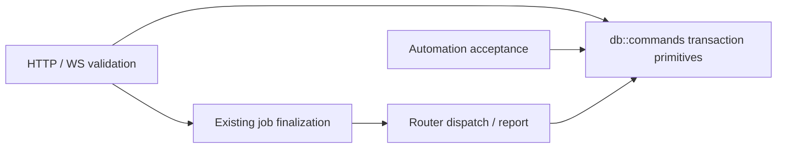

# Durable command transaction boundary

## Problem

HTTP/WS commands, timer/webhook events and Router dispatches/reports use the same
message acceptance transaction. Keeping its implementation in `api::commands`
requires Router to call the HTTP module, while that module's worker finalization
calls Router to persist a report. A second queue or a separately committed report
would break existing crash and occupancy guarantees.

## Decision

`db::commands` owns the existing transaction primitives and their input records.
`api::commands` retains validation, receipt lookup, request normalization, approvals,
transaction ownership and the worker loop. Router and automation call the same
storage functions directly. The public `api::commands::Command` and `now` paths
remain available. JSON fields, digest bytes, SQL and operation order stay compatible.

The store takes an already authorized/prepared input and the caller's mutable
transaction. It does not start, commit, retry or recover a transaction, acquire a
write lock, grant approval, signal cancellation or launch a worker. Callers roll
back after an error. The core's uniqueness constraints supplement the existing
receipt checks; calling the insert primitive alone is not an idempotent command API.

| Existing operation | Preserved contract |
| --- | --- |
| Message acceptance | Allocate message sequence; insert message with `context_admitted=0`; reserve turn; link message; write `user_message` at stream seq 0; insert/update job; insert receipt in one transaction. |
| Busy thread | Only pending/running/waiting turns make the new turn queued. History is admitted by the existing claimant, not acceptance. |
| Stream collision | A request ID already used by a job or event gets a fresh stream ID. The request/receipt identity stays unchanged. |
| Job reuse | Rotate turn/stream/message/payload; keep the original request, generation, worker/occupancy fields and old receipt. Admission retains its separate old-worker fences. |
| Authorship | Human attachment metadata, Router agent dispatch metadata, system task reports and automation metadata keep their existing representation. |
| Paused thread | Only paused changes to active; interrupted messages become visible. Pending approvals and scheduler turns are not consumed by this helper. |
| Unclaimed cancellation | Only queued jobs with no active worker and queued/pending turns change; write the existing guarded terminal pair. Repeated calls do not append it again. |
| Turn cancellation | Use SchedulerStore's transaction primitive; keep claimed-worker occupancy; cancel only approvals linked to that turn's checkpoint; only unclaimed streams get immediate terminal pairs. Signal the live registry after commit. |

Storage errors retain their SQLx or SchedulerStore cause. Their boundary messages
remain `database error` and `failed to cancel turn`; HTTP still returns status 500,
code `internal_error`, empty details, and never the private database error. Router
keeps its previous text and report `sqlx::Error::Protocol` mapping.

The persistence module still reuses the existing runtime attachment record and
SchedulerStore cancellation primitive. This extraction does not remove every
Runtime/API dependency: topic routing, workspace preflight, approval admission,
worker execution and recovery retain their present owners.

## Alternatives considered

Keeping the existing implementation has the smallest immediate diff and already
shares one transaction core, but retains the cross-layer business dependency.
Moving the whole command service would also move approvals, recovery and worker
ownership, enlarging the verification surface unnecessarily. Returning `ApiError`
from storage would preserve signatures, but keep an HTTP dependency; two concrete
storage error cases preserve the existing boundary messages without a new framework.

## Consequences

Acceptance has one storage owner and caller-controlled commit boundaries. The
cost is a module and explicit error conversion at existing boundaries. Revisit if
the primitive needs transport/session state, if a new caller cannot preserve the
transaction or authorization preconditions, or if old-worker/approval/replay
tests diverge. No performance improvement is claimed. Reverting the extraction
restores the old implementation locations without a database migration.

The characterization tests use real migrations, SQL writes and failing triggers.
Unit tests cover identities, payloads, queue selection, rollback, stream collisions,
reuse, paused threads and cancellation. Realtime tests cover HTTP failure envelopes
and rollback; existing tests cover HTTP/WS receipt sharing, concurrent duplicates,
Router execution/reports, automation, restart, approval and old-worker fences.
