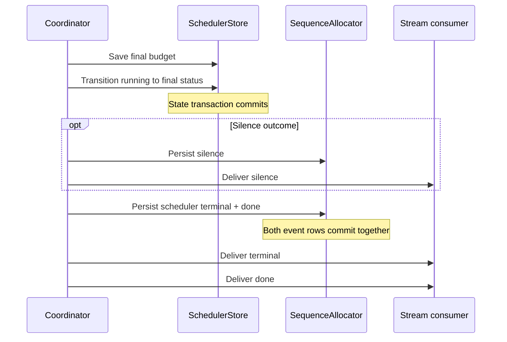

# Scheduler terminal ordering

This contract describes the existing host behavior. A turn status change and its
stream events use separate existing transactions. Refactoring must preserve their
order and error paths; this document does not introduce a new atomicity promise.

| Path | Durable state before event delivery | Event tail | Outcome |
| --- | --- | --- | --- |
| Normal finish | Flush decision usage, save budget, transition `running` to final status | Optional `silence`, then scheduler terminal + `done` | Existing visible/failure/budget classification |
| ACP failure | Finish failed dispatch, save budget, transition to `failed` | `turn_completed` + `done` | Error |
| Cancellation | Clear current dispatch, idempotent `cancel_turn`, read persisted status/budget | `turn_cancelled`, `turn_superseded`, or existing-final `turn_completed`, then `done` | Cancelled |
| Persistence failure | Load trace; try `failed/persistence_failed` only when not already terminal | `error`, then `done`, if those writes remain possible | Error, or cancellation marker when emitting error fails |
| Waiting for user | Commit waiting status; preserve checkpoint/approval ownership | `done`; no scheduler terminal pair | WaitingForUser |

The terminal pair is atomic within `SequenceAllocator::persist_events`. Failure
inserting `done` rolls back the terminal row too. A failed pair can leave a gap
in the in-memory sequence; event ids and sequences must not be regenerated or
renumbered as a side effect of this refactor. State already committed before an
event failure remains committed; failure cleanup does not rewrite it.

Cancellation deliberately uses the persisted snapshot. If another path already
completed the turn, `cancel_turn` preserves that status. Cancellation emits
`turn_completed` for any existing final status other than cancelled/superseded,
including a previously budget-exhausted turn; normal budget completion emits
`turn_budget_exhausted`. These mappings are intentionally characterized separately.

`waiting_for_user` is resumable and is excluded from the terminal-state predicate.
Its `done` ends this stream without declaring the persisted turn irreversibly
complete. The decision-model waiting path emits its existing waiting event before
the waiting transition. This refactor does not reorder that flow.

Failure cleanup is best effort: if the failed-state write also fails, it logs the
failure and still attempts error/done. If cancellation prevents error emission,
the database work already committed is retained. No failed or uncertain external
tool operation is retried by terminal cleanup.
