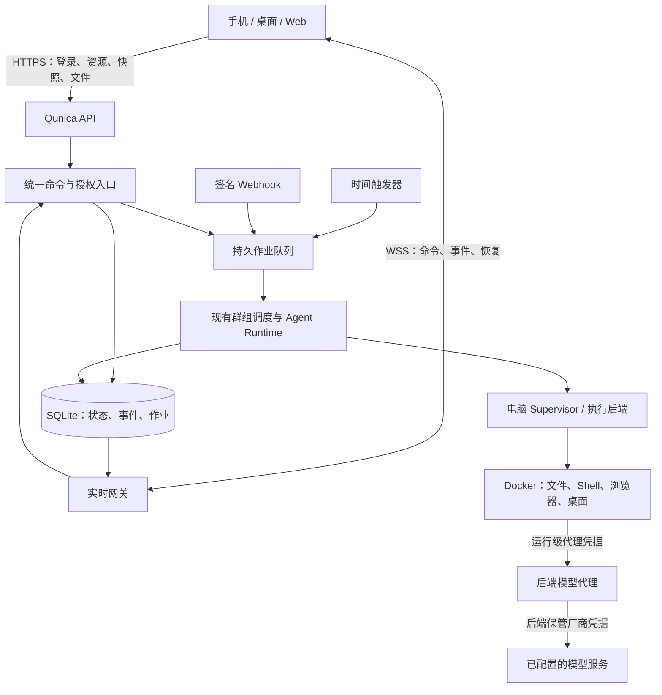

# Qunica 服务端同步、受控电脑与自动触发 Spec

Status: proposed
Implementation: M1/M2a/M2b/M3 development implemented locally; external device/VPS/model/performance acceptance pending
Version: 0.7
Since: 2026-10-17
Author: codex-sol-6.1
Review: dsv4.1-flash 在 0.2 中完成代码核对和修订；用户在 2026-10-17 明确选择保留配对链路、容器模型请求由后端代理转发。codex-sol-6.1 据此更新 0.3 的兼容范围、代理合同与验收要求（见同步及受控电脑 Spec，以及 10.6、10.7）。claude-opus-5 的评审经用户确认后写入 0.4：配对链路经 SSE 获得账号事件、旧令牌改为重新登录、模型代理与自研页面工具后移、群级 job 互斥限于 M3、文档按阶段拆分（见 10.8–10.12）。整体实施状态见下列实现进度。

本文定义目标行为。除“现状”与下列已验证子集外，接口、表、协议和默认值均为提案，不表示功能已经存在。优先级、VPS 直连、保留配对与后端模型代理来自用户明确要求；工程细节按以下合同实现和验证。

实现进度（2026-10-19）：M1a/M1b 和 M3 的开发路径已在本地实现；账号同步、可撤销设备会话、统一命令/作业、审批恢复、直连 WS、配对账号 SSE、远程终端和自动触发保持既有合同。M2a/M2b 补齐显式电脑绑定、受控文件/Shell、Chromium/Playwright MCP、noVNC 接管、受控出口、持久 home 与停机备份、后端模型代理、容器 OpenCode ACP 及群笔记桥；未知外部副作用仍要求人工确认停止，不能回退宿主或盲目重放。部署及实现见 [受控电脑](../backend-rs/crates/backend/src/docs/guide/computers.md)，M2 证据见 [本地验收](computers-local-acceptance.md)。M1、M3 验收记录分别见 [多端同步](realtime-sync-local-acceptance.md) 和 [自动触发](automations-local-acceptance.md)。真实三端、VPS TLS、完整 Noise、真实模型与性能项目仍需独立验收；开发实现与整体外部验收分别记录，整份 Spec 保持 proposed。

## 1. 目标与范围

按以下顺序交付：

1. P0：手机、桌面、Web 直连同一后端，通过 WebSocket 同步状态。
2. P1：浏览器、沙箱与 computer use，包括可观察、可接管的执行环境。
3. P2：时间与外部事件唤醒群组，复用现有调度器和审批。

远程部署中，VPS 运行完整 Qunica 后端、数据存储与执行环境。客户端输入域名或 IP 直接连接，VPS 不承担连接另一台桌面的 TCP 中继角色。客户端关闭后，已接收的任务仍由服务端管理。

同时保留手机连接可达桌面实例的加密配对方式，不设置配对链路下线时间。VPS 直连和桌面配对是两个明确入口，保留配对不意味着 VPS 直连必须经过中继，也不自动增加家庭网络穿透能力。

第一版采用单实例 Rust 后端、SQLite 和后台作业循环。这里的同步是多个客户端连接同一实例；多个独立后端的数据复制、离线编辑合并、远程调用用户家中电脑上的 CLI、多副本后端和敌对租户托管均不在范围内。

本地桌面模式继续使用本机后端；选择远程实例后，工作区、CLI 登录和执行位置都属于远程服务器。不能把本机路径或本机 CLI 登录自动解释成服务器资源。

## 2. 设计时核实的现状（2026-10-17）

| 能力 | 当前事实与复用边界 |
| --- | --- |
| 运行事件 | `StreamEvent` 已有 `stream_id`、`seq`、`event_id`；适合保留为单次运行的恢复标识，不能直接充当跨运行的账号游标。 |
| SSE 恢复 | 已有持久事件、游标重放、客户端去重与重连；恢复通道目前按运行流跟随数据库，不是账号级变更订阅。 |
| 消息去重 | 发送接口已有 `client_request_id`，可映射到运行流；需补齐命令原子接收、不同载荷冲突及其他控制命令的语义。 |
| 活动状态 | 前端活动状态随本客户端的发送与恢复流登记；其他设备几乎不会主动发现：全局 `refetchOnWindowFocus: false`，群与任务列表不轮询，消息只在已看到 pending/running 回合且本端无流时按 2 秒轮询，群文件、工作区文件、Git 面板按 10 秒轮询。 |
| Android | 已有服务器地址设置（`normalizeServerOrigin` 要求 HTTPS、无路径、无凭据）、`changeAndroidServer` 与 Keystore 会话；`apiOrigin()` 在 Android 读会话里的 server。缺的是默认入口、服务端撤销与实时通道，不是地址配置能力。 |
| 桌面地址 | 默认后端为 loopback，另有构建期 API 地址；还需运行时选择本地或远程实例。 |
| 登录 | 后端只校验签名与主体，`validation.validate_exp = false`，连旧令牌的 `exp` 也忽略；没有 logout/revoke 路由，退出只清客户端。服务端设备会话撤销尚未建立。持续登录需求必须保留。 |
| 调度 | 已有持久回合、预算、取消和审批；互斥由 `ux_group_turns_one_active_thread`（0003 迁移）落在 thread 上，群级没有唯一约束，回合事务由全局 `write_lock` 串行化。 |
| 重启恢复 | `recover_incomplete_turns` 把 pending/running/waiting_for_user 的回合统一改为 `Failed(ServerRestart)`，running 派发改 interrupted、queued 派发改 cancelled，线程回 active/paused。等待用户审批的回合同样被判失败，与跨端审批和作业恢复直接冲突。 |
| 审批恢复 | `tool_approvals`（0019）只存已答决策与 thread 级 remembered 授权，属审计与授权记录；待答请求靠线程里已落库的 assistant tool_calls 重建，恢复入口是 `POST /api/v2/threads/:id/resume`。没有独立待答实体、载荷摘要和版本裁决。 |
| 终端 | `TerminalManager` 是进程内状态：每 owner 至多 12 个会话、每会话 VecDeque 环形缓冲与自增 seq。服务重启即丢会话；没有多客户端输入仲裁。 |
| 执行环境 | `cloud_sandbox` 是占位；本地文件、Shell、Git、ACP 才是现有执行路径。 |
| Docker 部署 | 当前 Compose 把 Docker socket 挂入应用容器；该路径不能成为受控电脑的隔离方案。 |

对应代码见文末索引。已有本地笔记中的消息归并、待发队列所有权和持久登录边界，应纳入迁移回归，不因替换传输而重新定义。

## 3. 总体结构

HTTP 和 WS 适配器调用同一命令服务；鉴权、幂等、审批、预算与执行入口不分叉。业务状态与其领域事件在同一数据库事务中写入；广播仅通知“有新数据”，数据库负责补齐事实。不得跨模型调用或工具执行持有数据库写事务。

WS 负责直连客户端与服务端之间的实时通信；保留的配对方式继续通过 Noise 通道，用 SSE 订阅同一账号事件和运行事件，命令走 HTTP。两种传输只是适配层，事件、快照与游标只有一套。模型厂商的流式协议、MCP 的 SSE/HTTP transport 不属于这次替换范围。容器中的模型调用经后端模型代理，不把厂商凭据发给容器。

## 4. P0：多端同步

完整合同与验收见 [多端同步 Spec](realtime-sync.md)。

## 5. P1：受控电脑

完整合同与验收见 [受控电脑 Spec](controlled-computers.md)。

## 6. P2：自动触发

完整合同与验收见 [自动触发 Spec](automations.md)。

## 7. 数据与接口增量

以下为概念表，最终 migration 序号按落地时仓库状态分配：

| 表/结构 | 最低要求 |
| --- | --- |
| `server_identity` | 持久 server_id；备份恢复、克隆为新实例时有显式身份规则。 |
| `auth_sessions` | owner、session、凭据标识、撤销时间、设备标签；不存明文凭据。旧令牌直接拒绝，不建消费记录表。 |
| `account_events` / sequence counter | owner + 单调序号唯一，资源、版本、事件载荷与清理边界。 |
| `command_receipts` | owner + request_id 唯一，目标与载荷摘要、持久结果；job/turn 保留期间不得删掉去重锚点。 |
| pending approval 实体 | 不可变载荷摘要、tool_call/thread、状态、版本、裁决结果；与现有 `tool_approvals` 审计记录关联，但不改变它“已答决策/remembered 授权”的语义。 |
| `execution_jobs` | 来源、关联 thread/turn/stream、状态、预算、执行租约/generation、失败与恢复信息；群内活动态唯一约束（owner + group）在 M3 迁移中加入，M1 建表时不加。 |
| `computers` / control leases | provider、home、能力、绑定与状态；电脑和人工控制的租约不得混为登录会话。 |
| 模型代理 grants / 调用记录 | owner、computer generation、agent、job/turn、允许的 provider/model、过期/撤销和预算；代理凭据只存不可逆标识，用 model_call_id 对账，不复制厂商密钥。 |
| `automations` / `trigger_occurrences` | 配置版本、时区、next_run、唯一发生键、payload 摘要、入队结果。 |

接口增量包括实例能力、设备会话与撤销、WS ticket、实时连接、账号/线程快照、命令查询、电脑生命周期与控制、内部模型代理、自动任务 CRUD/预览/试运行及 Webhook。现有群、任务、文件、Git、模型和 MCP 资源接口复用，不能把底层模型流或私密密钥原样广播。

数据库迁移必须备份并可重复验证。代码回退不能直接丢弃新事件、会话或已接收作业；以维护模式和经过验证的备份恢复作为重大 schema 回退边界。

## 8. 分阶段交付门槛

| 阶段 | 必须交付 | 完成标准 |
| --- | --- | --- |
| M1a | 统一命令、持久接收、账号事件、快照、`auth_sessions`（旧令牌 401 重新登录）、WS，修正等待审批的重启恢复 | 同一后端两台客户端收发与恢复正确，业务执行脱离连接生命周期，重启后仍可裁决待审批请求。 |
| M1b | 桌面/Android 服务器选择、VPS 直连、远程终端、直连迁移至 WS、配对账号事件 SSE | 直连三端共享任务与审批且手机无需桌面和中继；配对端能发现其他设备的变化且既有功能回归；完成 P0 验收。 |
| M2a | 移出 Compose 的 Docker socket、Docker Supervisor、内置 Runtime 的受控文件/Shell、Chromium + Playwright MCP、noVNC 接管、持久 home | 在真实容器中完成网页下载、产物验证、人工接管和重启恢复；不含模型代理。 |
| M2b | 后端模型代理、至少一个 ACP preset 的电脑内执行与群笔记桥 | 代理授权、流式转发、撤销合同通过；工具实际执行位置、代理推理与用量、取消、恢复均通过；其余 preset 明确报告不支持。 |
| M3 | 持久定时器、签名 Webhook、统一作业恢复与控制 | 无客户端在线时执行，重启不丢已接收工作，重复事件不重复入队。 |

## 9. 验收与测试

- [P0 同步验收](realtime-sync.md#p0-必须通过)
- [P1 受控电脑验收](controlled-computers.md#p1-必须通过)
- [P2 自动触发验收](automations.md#p2-必须通过)

验证包含协议/状态机、真实 API+SQLite 集成、三端交互与显式启用的真实模型评测；没有实测的设备、Docker、TLS 或性能项目不标为通过。

## 10. 评审焦点与已确认决定

下列记录区分技术默认方案与用户已确认的选择；不把设计认可写成功能已实施：

1. **事件恢复**：采用账号低频事件 + 单次运行细节两类游标；相比全量 token 进入账号日志，降低重复存储，同时要求快照边界严格一致。
2. **命令与认证**：沿用 HTTP 资源接口，WS 承载四类高频命令；增加可撤销但不按时间失效的设备会话，保持持久登录；旧令牌要求重新登录一次（见 10.9）。
3. **执行隔离**：先 Docker 和一个活动桌面；ACP 需容器内执行，不能用“支持浏览器 MCP”代替 Runtime 隔离。
4. **跨任务并发**：同群不同任务线程并行，job 按 owner + thread 占用；同线程收尾、审批和重启确认依次执行。同一自动任务的发生项及共享电脑分别保留互斥，共享文件隔离复用分支任务/worktree。合同见 [自动触发队列](automations.md#64-队列竞争与恢复)。
5. **重启语义**：queued 自动恢复、执行中中断谨慎恢复；可靠性目标是工作不丢和副作用不盲目重放，不是无条件自动重跑。
6. **配对链路保留（用户已确认，2026-10-17）**：保留手机连接桌面实例的加密配对方式，不设置下线时间；P0 直连用 WSS，配对经 SSE 订阅同一账号事件（见 10.8）。只保留直连可减少一种传输适配，但违背用户保留要求，因此不采用。收益是保留现有访问方式；代价是两种传输的兼容回归。出现 SSE 无法满足配对延迟或流量要求时，重访原生 WS 桥，不重新解释成下线授权。
7. **后端代理模型请求（用户已确认，2026-10-17）**：容器模型请求经后端代理，厂商凭据留在后端，合同见 5.5。厂商短期令牌直发容器可省去代理流量和协议适配，但扩大凭据暴露面且不符合用户选择，因此不采用。容器的运行级代理凭据仅授权 Qunica 代理，不是该替代方案中的厂商令牌。收益是集中认证、预算和撤销；代价是后端流量、流式适配与 ACP 兼容验证。出现代理瓶颈或 preset 无法代理时，重访容量/适配方案，不静默回退为下发厂商凭据。

8. **配对链路的账号事件走 SSE（用户确认，0.4）**：`lanFetch` 已支持流式响应，账号事件加一个 SSE 适配即可让配对端跨端发现变化。原生 WS 桥能统一传输，但要改 src-tauri 原生层并长期维护，收益只是传输一致；不做则配对端看不到其他设备的新任务和审批。代价是多一个薄适配接口，事件层仍只有一套。
9. **旧令牌直接要求重新登录（用户确认，0.4）**：一次性升级能让用户无感迁移，但需要持久化消费记录、防重复兑换，并为只用一次的迁移长期保留代码。改为旧令牌返回 401 后重新登录一次，持续登录需求不变。代价是每台设备在升级后登录一次。出现大量设备无法交互登录（如无人值守客户端）时重访。
10. **后移模型代理、先用现成浏览器组件（用户确认，0.4）**：在 M2a 同时做代理可提前验证代理架构，但内置 Runtime 在后端推理，M2a 用不到代理；代理与容器内 ACP 一起在 M2b 交付。自研页面工具能精确控制引用 generation，但先用 Playwright MCP 与 noVNC 跑通流程成本更低，缺口实测后再补。出现现成组件无法满足引用校验或接管互斥时，转为自研。
11. **job 线程级互斥**：所有入口使用 `ux_execution_jobs_thread_owner` 与独立 worker 占用；群级互斥阻塞独立任务，因此迁移 0046 将其收窄到线程。恢复确认只释放目标线程；跨线程并发及共享资源边界见 [群组任务](../backend-rs/crates/backend/src/docs/guide/groups.md#managing-tasks)。
12. **按阶段拆分文档（用户确认，0.4）**：单一文档便于看全局依赖，但三个阶段各自评审、实施和标记状态时互相牵连。同步、受控电脑、自动触发已拆为三份 spec，本文保留为索引及跨阶段约定；各阶段完成验证后独立标记 implemented。P2 在 M1a 之后主要复用已有能力，若 P1 受阻于 Docker 或 ACP 兼容，可先交付 P2；默认顺序仍按用户优先级。

评审反馈应原地更新本文的决定、替代方案与验收项。0.4 落实 claude-opus-5 经用户确认的评审（10.8–10.12）。0.2 包含 dsv4.1-flash 的代码核对评审，0.3 落实用户对 10.6、10.7 的明确选择；这两项不再等待用户拍板。新增工程合同接受后续实现评审，实现与验证完成前本文保持 proposed，不改 implemented。

## 11. 依据与代码索引

现状依据（相对本文件）：

- [事件模型](../backend-rs/crates/domain/src/events.rs)
- [SSE 重放](../backend-rs/crates/backend/src/api/sse_replay.rs) 与 [前端重连](../frontend/src/lib/api-v2/sse.ts)
- [消息接收入口](../backend-rs/crates/backend/src/api/messages.rs) 与 [服务端顺序分配](../backend-rs/crates/backend/src/runtime/sequence.rs)
- [前端活动状态](../frontend/src/stores/conversationActivityStore.ts)
- [Android 服务器会话](../frontend/src/lib/androidSession.ts) 与 [服务器地址选择](../frontend/src/lib/runtime.ts)
- [认证实现](../backend-rs/crates/backend/src/api/auth.rs) 与 [持久登录说明](../backend-rs/crates/backend/src/docs/guide/settings.md)
- [调度持久化与重启](../backend-rs/crates/backend/src/runtime/group_scheduler/store.rs)
- [工作区能力](../backend-rs/crates/backend/src/docs/guide/workspaces.md) 与 [ACP 集成](../backend-rs/crates/backend/src/docs/guide/external-cli-agents.md)
- [审批记录](../backend-rs/crates/backend/src/db/migrations/0019_tool_approvals.sql)、[审批恢复说明](../backend-rs/crates/backend/src/runtime/approval.rs) 与 [终端会话](../backend-rs/crates/backend/src/terminal.rs)
- [前端轮询](../frontend/src/hooks/useGroupMessages.ts)，用于替换为账号事件后的降级对照
- [Docker 部署](../DOCKER.md)、[Compose](../docker-compose.yml) 与 [反向代理配置](../docker/Caddyfile.mobile)

外部协议依据：[RFC 6455](https://datatracker.ietf.org/doc/html/rfc6455)、[浏览器 WebSocket API 与背压限制](https://developer.mozilla.org/en-US/docs/Web/API/WebSocket)、[Docker Engine 安全边界](https://docs.docker.com/engine/security/)。外部协议资料用于约束设计，不证明本项目已经实现相应能力。
